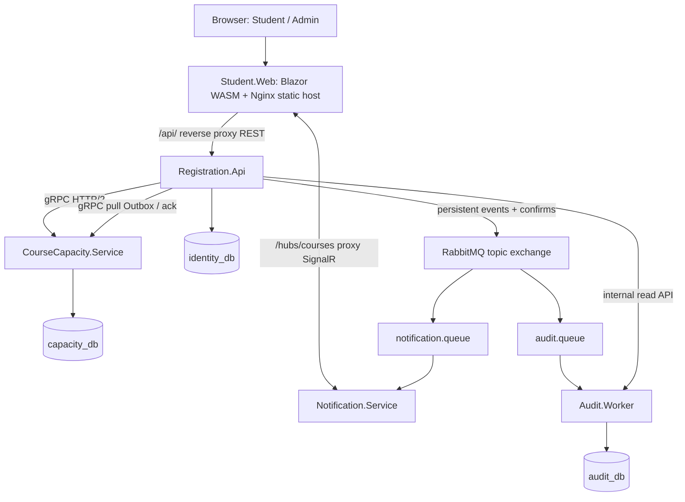
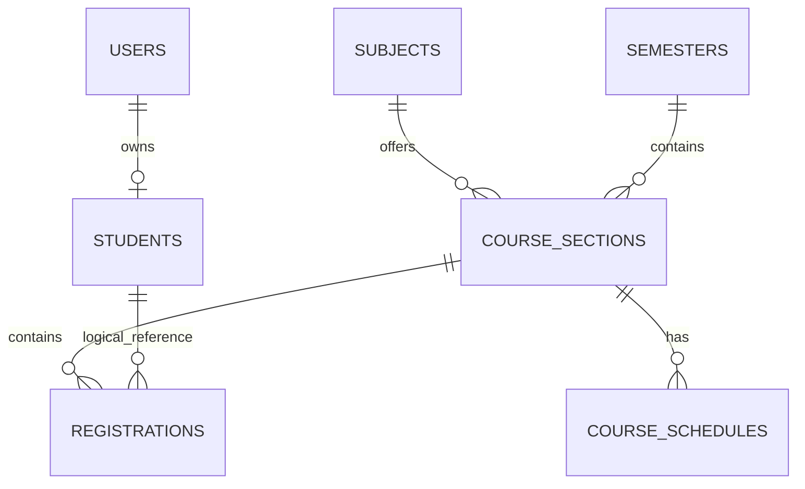

# MASTER PLAN — HỆ THỐNG ĐĂNG KÝ HỌC PHẦN THỜI GIAN THỰC

> Tài liệu đặc tả, kiến trúc, hướng dẫn thực thi và bộ nhiệm vụ (prompts) dành cho AI Coding Agent. Đây là **một file duy nhất** làm nguồn sự thật của dự án. Đọc toàn bộ trước khi viết code, sau đó làm theo thứ tự các bước. Không sinh toàn bộ dự án trong một lần.

**Tên tiếng Anh:** Real-time Course Registration System  
**Repository:** `realtime-course-registration`  
**Solution:** `RealtimeCourseRegistration.slnx` (nếu SDK thực tế dùng `.sln` thì giữ một định dạng duy nhất và cập nhật các lệnh tương ứng)  
**Học phần:** Phát triển ứng dụng phân tán — Đề tài 02  
**Môi trường mục tiêu:** Windows, VS Code, PowerShell, Docker Desktop với Linux containers, .NET 10.  
**Ngôn ngữ UI/tài liệu:** tiếng Việt; identifier, code, commit và hợp đồng giao tiếp bằng tiếng Anh.  
**Trạng thái:** thiết kế đã đề xuất để thực thi; chưa có mã nguồn hoặc kết quả kiểm thử thực tế trong tài liệu này.

---

## 0. PROMPT CHÍNH — DÁN CHO AI TRƯỚC KHI BẮT ĐẦU

```text
You are the senior software engineer implementing the Real-time Course Registration System coursework project. Treat this Markdown file as the single source of truth for the requirements, architecture, scope, and implementation sequence.

Read the entire file first, then inspect the actual repository and environment. Implement only the next incomplete numbered task (T00–T30) unless the user explicitly requests a different task or an authorized batch. Do not rewrite completed working code, invent files/test results, switch the technology stack, or add unapproved scope. Keep implementation small, understandable, maintainable, and suitable for a university distributed-systems demonstration.

Use C# and .NET 10, ASP.NET Core Minimal APIs, Blazor WebAssembly, PostgreSQL/EF Core, gRPC, RabbitMQ, SignalR, Docker Compose and Git. Preserve the five mandatory REST paths exactly. Maintain correct service ownership, transactional registration and cancellation, idempotency, transactional outbox, reliable event fan-out, SignalR reconciliation, and independent auditing. Never claim exactly-once delivery.

Before each task, inspect git status and existing files, state the intended changes, and read related contracts. After implementation, actually run the relevant build/tests and inspect their output. Do not mark a task complete unless its acceptance criteria have been verified. Record blocked checks honestly, with the actual command and error. Keep the repository in a working state. Update docs/progress.md with real evidence and the next task. Commit only real work; do not fabricate timestamps or history. Do not push, delete volumes, reset branches, overwrite user work, or publish secrets without explicit authorization.

Use Vietnamese for explanations and user-facing UI. Write clear English identifiers, structured logs, and conventional commit messages. At the end of each task report changed files, design decisions, commands actually run, results, limitations, and the suggested commit. Stop after the requested task and wait for the next instruction.

Start with T00, unless the repository already contains verified completed tasks. Do not ask the user to repeat information already specified in this file.
```

### Cách sử dụng

1. Lưu file này ở thư mục gốc repo với tên `MASTER_PLAN.md`. Giữ bản tài liệu gốc của giảng viên trong `docs/source/` nếu có quyền sử dụng.
2. Mở **thư mục gốc** bằng VS Code, sử dụng AI có quyền đọc/chỉnh sửa file và chạy terminal (nếu có). Đưa AI file này và prompt chính ở trên.
3. Giao từng nhiệm vụ: `Đọc MASTER_PLAN.md, thực hiện T00, chạy kiểm tra thực tế và cập nhật docs/progress.md.` Sau khi xong, giao T01, T02... Không yêu cầu AI làm tất cả trong một prompt.
4. Khi AI báo lỗi, yêu cầu sửa đúng lỗi trong nhiệm vụ hiện tại, chạy lại kiểm tra; không nhảy bước khi chưa đạt điều kiện. Nếu công cụ AI không có quyền chạy lệnh, yêu cầu cung cấp lệnh cần chạy và ghi rõ chưa kiểm chứng.
5. Không dùng tài liệu này thay cho yêu cầu chính thức. Khi có mâu thuẫn, yêu cầu của giảng viên ưu tiên; ghi lại thay đổi và cập nhật hợp đồng trước khi code tiếp.

## 1. YÊU CẦU GỐC VÀ PHẠM VI CHỐT

### 1.1. Nguồn yêu cầu

- Ảnh “Hướng dẫn chung cho bài tập lớn” của học phần Phát triển ứng dụng phân tán.
- File `02-he-thong-dang-ky-hoc-phan-thoi-gian-thuc.md` do người dùng cung cấp, gồm mô tả, 8 chức năng chính, 5 REST endpoint tối thiểu và yêu cầu gRPC/RabbitMQ/dữ liệu.
- Các quyết định PostgreSQL, Blazor, JWT, quản trị, Outbox, idempotency, CI, mục tiêu hiệu năng và lịch 8 tuần là **thiết kế đề xuất**, không phải yêu cầu nguyên văn của giảng viên.

### 1.2. Yêu cầu bắt buộc (P0)

| ID | Yêu cầu | Nơi hiện thực | Bằng chứng nghiệm thu |
|---|---|---|---|
| R01 | C#, .NET 10, ASP.NET Core Minimal API | Registration.Api, các host API | `dotnet build`, csproj net10.0 |
| R02 | Client Console hoặc Web; chọn Web | Student.Web | Demo giao diện hoạt động |
| R03 | Danh sách lớp và số chỗ, chi tiết lớp | REST → gRPC → DB | GET /courses, GET /courses/{id} |
| R04 | Đăng ký, hủy đăng ký | REST → gRPC | POST /registrations, DELETE /registrations/{id} |
| R05 | Không trùng, không quá sức chứa | Capacity transaction + unique index | Test đồng thời và trùng |
| R06 | Kiểm tra, giữ/trả chỗ qua gRPC | CourseCapacity.Service | gRPC contract và log thực tế |
| R07 | Phát RegistrationCreated/RegistrationCancelled qua RabbitMQ | Registration.Api publisher | Exchange, routing keys, message confirms |
| R08 | Cùng event đến nhiều subscriber | Notification.Service + Audit.Worker | Hai queue riêng, cả hai xử lý |
| R09 | SignalR cập nhật số chỗ theo thời gian thực | Notification.Service → Student.Web | Hai trình duyệt, không reload |
| R10 | Audit Worker lưu lịch sử | audit_db | Đối chiếu eventId, không trùng |
| R11 | Tra cứu học phần của sinh viên | GET /students/{studentId}/registrations | API/UI và test quyền |
| R12 | Dữ liệu sinh viên, lớp, sức chứa, số đăng ký, trạng thái | PostgreSQL | Migrations + seed + dữ liệu thực |
| R13 | Service chạy độc lập, mỗi service .NET có Dockerfile | 5 deployable projects | Compose up, restart từng service |
| R14 | Docker Compose, service name, Docker network | docker-compose.yml | Không dùng localhost giữa container |
| R15 | Cấu hình môi trường tách mã nguồn | env, config | .env.example, secrets không commit |
| R16 | Logging và phục hồi lỗi hợp lý | Tất cả service | Correlation ID, outage tests |
| R17 | Git, GitHub, lịch sử commit thật | Repository | Log, remote, commits |
| R18 | Báo cáo, README, sơ đồ, máy cá nhân demo được | docs/ + repo | Checklist bàn giao |

### 1.3. Phạm vi hoàn thiện (P1, sau nghiệp vụ P0)

- Xác thực tài khoản, JWT Bearer, hai role Student và Admin; không cần tự đăng ký tài khoản công khai. Tài khoản demo được seed.
- Sinh viên: tổng quan, tìm kiếm/lọc lớp, đăng ký/hủy, học phần của tôi, số tín chỉ, thời khóa biểu, lịch sử cá nhân, hồ sơ cơ bản.
- Admin: tổng quan, tạo/sửa môn học và lớp, lịch học, điều chỉnh sức chứa, mở/đóng đăng ký, xem danh sách sinh viên/lượt đăng ký, audit log có phân trang. Không xóa cứng dữ liệu đang được sử dụng.
- Transactional Outbox, idempotency, version dữ liệu, retry/health check, cấu hình bí mật, CI và kiểm thử lỗi là chất lượng kiến trúc cần làm trong phương án này.
- Giao diện đẹp, responsive, accessibility cơ bản, thông báo lỗi rõ ràng, trạng thái kết nối thời gian thực.

### 1.4. Không thuộc phạm vi (P2 — không tự triển khai)

Thanh toán học phí, đăng ký tín chỉ thay sinh viên, quy trình phê duyệt nhiều cấp, quản lý điểm, thời khóa biểu tối ưu tự động, phân công giảng viên, OTP, email/SMS, OAuth xã hội, AI, app mobile native, Redis cluster, Kubernetes, Kafka, Elasticsearch, microservice xác thực riêng, nhiều replica production.

Kiểm tra xung đột lịch học hoặc giới hạn tín chỉ là **mở rộng tùy chọn**, không bật mặc định. Nếu sau này triển khai thì phải bảo vệ đồng thời theo sinh viên và cập nhật test; không hứa chặn trùng lịch nếu chưa làm.

## 2. KIẾN TRÚC CHỐT

### 2.1. Sơ đồ tổng thể



5 project deployable, 1 project thư viện hợp đồng dùng chung, 1 container PostgreSQL và 1 container RabbitMQ. Nginx nằm **trong container Student.Web**, chỉ phục vụ static assets và reverse proxy; không thêm API Gateway service. PostgreSQL có 3 database logic và tài khoản riêng, cùng một container để tiết kiệm tài nguyên. Không truy cập chéo database trực tiếp.

### 2.2. Trách nhiệm và ranh giới

| Project | Trách nhiệm | Không được làm |
|---|---|---|
| Registration.Api | Minimal REST, xác thực/phân quyền, gRPC client, quản lý identity, background publisher đọc Outbox qua gRPC, proxy audit query nội bộ | Không ghi bảng đăng ký/sức chứa trực tiếp; không đọc audit_db |
| CourseCapacity.Service | gRPC server, sở hữu môn học/lớp/lịch học/đăng ký, transaction, operation ledger, Outbox | Không public REST cho browser, không publish RabbitMQ trực tiếp trong phương án chốt |
| Notification.Service | SignalR Hub, consumer RabbitMQ, phát snapshot sức chứa theo nhóm | Không quyết định đăng ký, không sửa DB nghiệp vụ |
| Audit.Worker | BackgroundService consumer, audit_db, Minimal API nội bộ read-only phục vụ admin/health | Không ghi vào capacity_db; không nhận truy cập trực tiếp từ browser |
| Student.Web | Blazor WebAssembly, Student/Admin UI, HTTP + SignalR clients, Nginx hosting | Không truy cập gRPC/DB/RabbitMQ trực tiếp, không tự quyết định sức chứa |
| Shared.Contracts | Protobuf, integration event DTO, hằng số hợp đồng dùng chung | Không chứa EF entity, DbContext, logic nghiệp vụ, secrets |

Chỉ cho phép project references tới Shared.Contracts hoặc test tới project đang test; không reference source trực tiếp từ service này sang service khác. Không dùng shared database cho hai service nghiệp vụ. Lựa chọn để Capacity sở hữu cả enrollment và số chỗ giúp hai thay đổi nhất quán bằng một transaction; phù hợp kiến trúc tối thiểu, không cần Saga/2PC.

### 2.3. Công nghệ và dependency

| Thành phần | Công nghệ |
|---|---|
| SDK | .NET SDK 10, tất cả app `net10.0` |
| HTTP server | ASP.NET Core Minimal API, ProblemDetails |
| Frontend | Blazor WebAssembly standalone, Bootstrap 5/CSS tự viết, HttpClient, SignalR .NET client |
| Data | PostgreSQL, EF Core 10, Npgsql provider tương thích EF Core 10 |
| gRPC | Grpc.AspNetCore, Grpc.Net.ClientFactory, Google.Protobuf, Grpc.Tools theo project cần dùng |
| Messaging | RabbitMQ.Client stable tương thích .NET 10, async API, publisher confirms |
| Security | JwtBearer, ASP.NET Core PasswordHasher, rate limiting, policy authorization |
| Docs API | ASP.NET Core OpenAPI, Scalar nếu tương thích; chỉ bật UI tài liệu ở Development/demo có kiểm soát |
| Testing | xUnit, Microsoft.AspNetCore.Mvc.Testing, Testcontainers PostgreSQL/RabbitMQ, k6 (script riêng tùy chọn cài), Playwright nếu đủ thời gian |
| Logging | ILogger structured, JSON console, correlation ID |
| Deployment | Docker multi-stage, Compose v2, persistent volumes, healthchecks, GitHub Actions |

AI phải kiểm tra phiên bản SDK/package/image thật bằng tài liệu chính thức và lệnh restore; pin phiên bản ổn định tương thích, không tự bịa số phiên bản, không dùng `latest` trong Compose cuối cùng. Sử dụng `Directory.Packages.props` nếu quản lý version tập trung; `global.json` pin SDK thực tế tương thích .NET 10 (roll-forward phù hợp). Có thể dùng PostgreSQL 17 và RabbitMQ 4.x management nếu tag ổn định còn được hỗ trợ; chọn tag patch đã kiểm chứng trong T00/T03. Không cài gói preview chỉ để có API mới.

## 3. CẤU TRÚC REPOSITORY

```text
realtime-course-registration/
├── MASTER_PLAN.md
├── RealtimeCourseRegistration.slnx
├── global.json
├── Directory.Build.props
├── Directory.Packages.props
├── src/
│   ├── Registration.Api/
│   │   ├── Endpoints/       # Auth, Courses, Registrations, Admin, Health
│   │   ├── Authentication/  # JWT, password, policies
│   │   ├── GrpcClients/
│   │   ├── Messaging/      # OutboxPublisher, RabbitMqConnection
│   │   ├── Middleware/    # Correlation, error mapping
│   │   ├── Data/           # identity_db only
│   │   ├── DTOs/
│   │   ├── Program.cs
│   │   └── Dockerfile
│   ├── CourseCapacity.Service/
│   │   ├── GrpcServices/
│   │   ├── Services/      # Enrollment and course operations
│   │   ├── Data/          # capacity_db, migrations
│   │   ├── Entities/
│   │   ├── Program.cs
│   │   └── Dockerfile
│   ├── Notification.Service/
│   │   ├── Hubs/
│   │   ├── Consumers/
│   │   ├── Messaging/
│   │   ├── Program.cs
│   │   └── Dockerfile
│   ├── Audit.Worker/
│   │   ├── Consumers/
│   │   ├── Data/          # audit_db, migrations
│   │   ├── Endpoints/     # internal read/health
│   │   ├── Program.cs
│   │   └── Dockerfile
│   ├── Student.Web/
│   │   ├── Pages/          # Login, Student, Admin
│   │   ├── Components/
│   │   ├── Layout/
│   │   ├── Services/
│   │   ├── Models/
│   │   ├── wwwroot/
│   │   ├── Program.cs
│   │   └── Dockerfile
│   └── Shared.Contracts/
│       ├── Protos/capacity.proto
│       ├── Events/
│       └── Common/
├── tests/
│   ├── UnitTests/
│   ├── IntegrationTests/
│   └── LoadTests/
├── infrastructure/
│   ├── postgres/           # DB bootstrap, least privilege roles
│   ├── rabbitmq/           # topology documentation / bootstrap if needed
│   └── nginx/default.conf
├── scripts/
│   ├── setup.ps1
│   ├── seed-data.ps1
│   ├── smoke-test.ps1
│   └── demo-resilience.ps1  # reversible, no volume deletion
├── docs/
│   ├── source/
│   ├── requirements.md
│   ├── architecture.md
│   ├── database-design.md
│   ├── api-specification.md
│   ├── test-plan.md
│   ├── progress.md
│   ├── demo.md
│   ├── report.md
│   ├── decisions/
│   ├── diagrams/
│   └── screenshots/
├── .github/workflows/ci.yml
├── docker-compose.yml
├── .env.example
├── .gitignore
├── .dockerignore
└── README.md
```

Không tạo thư mục rỗng hàng loạt không có ý nghĩa, không làm mỗi lớp thành một project. Tạo dần theo nhiệm vụ. File `MASTER_PLAN.md` không thay thế README hoặc các tài liệu được rút ra/triển khai thật trong repo.

## 4. MÔ HÌNH DỮ LIỆU VÀ QUY TẮC NGHIỆP VỤ

### 4.1. Quy ước chung

UUID cho khóa chính, UTC `timestamptz` cho thời gian, số nguyên cho sức chứa/tín chỉ, `bigint` cho Version. JSON camelCase, API status string thống nhất, snake_case cho DB nếu chọn convention này thì áp dụng xuyên suốt. Mỗi DB có migration riêng và tên connection string riêng. Không dùng `EnsureCreated` thay cho migrations ở DB thực tế. Seed idempotent; dữ liệu demo giả lập, không sử dụng dữ liệu cá nhân thật.

### 4.2. identity_db (Registration.Api)

| Table | Cột chính | Ràng buộc |
|---|---|---|
| users | id, username, normalized_username, password_hash, role, is_active, created_at | unique normalized_username, role Student/Admin |
| students | id, user_id, student_code, full_name, email nullable, major nullable, created_at | unique user_id/student_code, FK users, một user Student có một hồ sơ |

JWT `sub` là User ID; `student_id` là Student ID (chỉ với Student); role claim chuẩn nhất quán giữa API/SignalR. Admin không cần Student ID. User không hoạt động không được login; token ngắn hạn, logout phía client xóa token. Nếu cần thu hồi token ngay lập tức thì mở rộng riêng, không tuyên bố đã có.

### 4.3. capacity_db (CourseCapacity.Service)

| Table | Cột chính | Ràng buộc |
|---|---|---|
| subjects | id, code, name, credits, is_active | unique code, credits > 0 |
| semesters | id, code, name, start_date, end_date, is_active | unique code, start_date <= end_date |
| course_sections | id, course_code, subject_id, semester_id, lecturer_name, capacity, registered_count, status, version, created_at, updated_at | unique (semester_id, course_code), FK nội bộ, capacity > 0, 0 <= registered_count <= capacity, version >= 0 |
| course_schedules | id, course_section_id, day_of_week, start_time, end_time, room | FK nội bộ, weekday 1–7, start < end; không trùng bản ghi lịch |
| registrations | id, student_id, course_section_id, status, created_at, cancelled_at | FK course section; Student ID tham chiếu logic sang identity_db; trạng thái Active/Cancelled; chỉ Active có cancelled_at null |
| processed_operations | operation_id, actor_id, operation_type, request_hash, outcome_code, response_json, created_at | unique (actor_id, operation_id); lưu kết quả cho retry, không lưu token |
| outbox_messages | event_id, event_type, aggregate_id, version, payload_json, occurred_at, published_at nullable | PK event_id, index pending, payload immutable |

PostgreSQL partial unique index trên `(student_id, course_section_id) WHERE status = 'Active'`. Có index tra cứu theo student_id, course_section_id, status và outbox pending. Không tạo foreign key xuyên database; xác thực Student ID từ JWT/identity service tại biên REST. Không cho browser gọi gRPC trực tiếp.

### 4.4. audit_db (Audit.Worker)

`audit_logs`: event_id (PK hoặc unique), event_type, schema_version, correlation_id, actor_id nullable, student_id nullable, registration_id nullable, course_section_id, capacity, registered_count, remaining_seats, version, occurred_at, received_at. Các event admin có trường student/registration null. Tạo index course_section_id + occurred_at, student_id + occurred_at. Append-only ở cấp nghiệp vụ, không cung cấp API sửa/xóa.

### 4.5. Quan hệ



Quan hệ STUDENTS–REGISTRATIONS là logic, không phải FK xuyên DB. Outbox và operation ledger lưu riêng trong capacity_db; audit_db là projection lịch sử độc lập.

### 4.6. Business rules (BR)

| ID | Quy tắc |
|---|---|
| BR01 | Chỉ Student đã xác thực mới được tạo/hủy đăng ký của chính mình; admin chỉ quản lý lớp và đọc dữ liệu cần thiết. |
| BR02 | Một student có tối đa một enrollment Active cho mỗi course section; đăng ký lại sau khi hủy là một enrollment ID mới. |
| BR03 | Chỉ đăng ký khi lớp Open và còn chỗ; không sử dụng kết quả CheckCapacity cũ để quyết định. |
| BR04 | RegisteredCount = số bản ghi Active; RemainingSeats = Capacity - RegisteredCount, không lưu cột RemainingSeats riêng. |
| BR05 | Giữ chỗ và tạo Active registration phải cùng transaction; hủy và giảm count cũng cùng transaction. |
| BR06 | Hủy chính enrollment Active của student; hủy lại enrollment đã Cancelled của chính chủ là no-op 204, không giảm count, không phát event mới. |
| BR07 | Lớp Closed không nhận đăng ký mới. Phương án demo cho phép sinh viên hủy cả khi Closed; UI ghi rõ. Không mặc định có thời hạn hủy. |
| BR08 | Admin chỉ được đặt capacity mới >= registered_count và > 0, cùng cơ chế đồng thời; không xóa cứng lớp/môn đang có liên kết. |
| BR09 | Mỗi thay đổi sức chứa/trạng thái thành công tăng Version trên course section một lần và tạo Outbox Event tương ứng. |
| BR10 | Operation ID ổn định qua retry; cùng actor + key + payload trả lại outcome cũ; cùng key nhưng payload khác bị từ chối 409. |
| BR11 | Sự kiện tích hợp chỉ phát sau commit; subscriber nhận lại cùng event phải xử lý an toàn. |
| BR12 | UI dùng server làm nguồn sự thật. Không tin studentId, số chỗ hoặc role từ body client. |
| BR13 | Thay đổi lịch/môn học phải hợp lệ; không triển khai ràng buộc trùng lịch của sinh viên hoặc hạn mức tín chỉ ở P0/P1. |

### 4.7. Dữ liệu mẫu nghiệm thu

- 1 admin, ít nhất 3 tài khoản Student riêng biệt; tạo thêm 100 tài khoản test tự động khi load test. Không dùng tài khoản thật.
- 1 học kỳ demo, 6 môn học, 8–12 lớp học phần, lịch học đa dạng; có lớp Open còn chỗ, lớp chỉ còn một chỗ, lớp đầy và lớp Closed.
- Seed registration và registered_count nhất quán. Ví dụ lớp `DISTRIBUTED-01` capacity 2, có 1 registration Active => còn 1 chỗ.
- Mật khẩu seed lấy từ env, không ghi mật khẩu thật vào repo; `README` hướng dẫn đặt env demo. Test fixture có thể dùng bí mật giả lập riêng.
- Seed idempotent, không reset dữ liệu khi restart, không chạy load test trên dữ liệu cần giữ; tạo lớp/fixture mới cho mỗi test.

## 5. HỢP ĐỒNG REST API

Đường dẫn nội bộ của Registration.Api **không đổi** so với đề bài. Browser gọi `/api/courses` thông qua Nginx; Nginx strip `/api/` để chuyển `/courses` tới service. Khi chạy trực tiếp API vẫn dùng `/courses`. Trình bày cả hai trong README.

### 5.1. Endpoint bắt buộc

| Method | Path | Quyền | Kết quả |
|---|---|---|---|
| GET | /courses | Student/Admin | 200 danh sách phân trang |
| GET | /courses/{id} | Student/Admin | 200 CourseDto; 404 |
| POST | /registrations | Student | 201 RegistrationResult; 409 trùng/đầy/đóng |
| DELETE | /registrations/{id} | Student chủ sở hữu | 204; 404 không tồn tại/không thuộc chủ |
| GET | /students/{studentId}/registrations | Student chính mình hoặc Admin | 200 danh sách; 403 sai quyền; 404 student không tồn tại |

GET /courses: `?search=&semesterId=&status=&page=1&pageSize=20`, tối đa 100, sắp xếp ổn định theo courseCode/id. Nếu không có filter trả tất cả lớp được hiển thị. `PagedResult<T>` = items, page, pageSize, totalCount. CourseDto: id, courseCode, subjectCode, subjectName, credits, semesterId, semesterName, lecturerName, schedules[], capacity, registeredCount, remainingSeats, status, version. Lịch học: dayOfWeek, startTime, endTime, room. Nếu truyền status không hợp lệ trả 400.

POST body: `{"courseSectionId":"<uuid>"}`. Header `Idempotency-Key: <uuid>` bắt buộc cho thao tác mutation enrollment. Student ID chỉ từ JWT claim. RegistrationResult: registrationId, studentId, courseSectionId, status, capacity, registeredCount, remainingSeats, version, createdAt. Trả Location trỏ tới tài nguyên thật nếu có endpoint đọc enrollment; không trỏ tới endpoint không tồn tại. Có thể trả 201 JSON không Location nếu không triển khai GET /registrations/{id}.

DELETE nhận cùng header Idempotency-Key; xác thực student ID từ token, không nhận body. Retry hủy cùng ID an toàn. GET registrations mặc định Active, hỗ trợ `?status=Active|Cancelled|All&page=1&pageSize=20` cho lịch sử; trả RegistrationDto có course snapshot hiện tại, credits, schedules, createdAt, cancelledAt. UI khi tính tổng tín chỉ phải tính toàn bộ Active (dùng endpoint summary/schedule hoặc lấy hết trang), không chỉ trang hiện tại.

### 5.2. Endpoint mở rộng đã chốt

| Method | Path | Quyền / ghi chú |
|---|---|---|
| POST | /auth/login | Anonymous, rate limit, username/password → accessToken, expiresAt, role, studentId, displayName |
| GET | /auth/me | Authenticated; profile tối thiểu |
| GET | /subjects | Authenticated, danh sách môn |
| GET | /semesters | Authenticated, học kỳ |
| GET | /students/me/schedule | Student, toàn bộ lịch Active theo học kỳ |
| GET | /students/me/summary | Student, totalActiveRegistrations, totalCredits theo học kỳ |
| GET | /admin/students | Admin, search + pagination, dữ liệu tối thiểu |
| POST | /admin/subjects | Admin, tạo môn |
| PUT | /admin/subjects/{id} | Admin, sửa code/name/credits; không xóa cứng |
| POST | /admin/courses | Admin, tạo lớp cùng schedules |
| PUT | /admin/courses/{id} | Admin, sửa metadata/schedules; không sửa count/capacity/status bằng endpoint này |
| PATCH | /admin/courses/{id}/capacity | Admin, body capacity + expectedVersion |
| PATCH | /admin/courses/{id}/status | Admin, body status + expectedVersion |
| GET | /admin/courses/{id}/registrations | Admin, student ID + thông tin tối thiểu join tại API qua identity_db, phân trang |
| GET | /admin/audit-logs | Admin, filter course/student/event/date, paginated; gọi Audit.Worker nội bộ |
| GET | /admin/statistics | Admin, thống kê số student/lớp/Active registrations/lớp đầy từ nguồn sở hữu, nếu dependency lỗi thì báo lỗi hoặc partial rõ ràng |
| GET | /health/live | Operational, không tiết lộ secrets |
| GET | /health/ready | Operational, trạng thái dependency thiết yếu |

Khởi tạo học kỳ bằng seed; không cần trang CRUD học kỳ riêng. Tạo/sửa lớp không đổi student/count; trường subject/semester của lớp đã có enrollment không được đổi tùy tiện. Admin mutation dùng Idempotency-Key cho tạo lớp, cập nhật capacity/status (và có thể dùng cho các mutation khác để đồng nhất), expectedVersion để chặn ghi đè do dữ liệu cũ. Nếu subject credits thay đổi, đây là demo dùng dữ liệu hiện hành; không tuyên bố quản lý lịch sử chương trình đào tạo.

### 5.3. HTTP status và lỗi

| HTTP | errorCode ví dụ |
|---|---|
| 400 | VALIDATION_ERROR, INVALID_IDEMPOTENCY_KEY |
| 401 | UNAUTHENTICATED, INVALID_CREDENTIALS |
| 403 | FORBIDDEN |
| 404 | COURSE_NOT_FOUND, REGISTRATION_NOT_FOUND, STUDENT_NOT_FOUND |
| 409 | ALREADY_REGISTERED, COURSE_FULL, COURSE_CLOSED, VERSION_CONFLICT, IDEMPOTENCY_CONFLICT, INVALID_CAPACITY |
| 429 | RATE_LIMITED |
| 503 | DEPENDENCY_UNAVAILABLE, OPERATION_OUTCOME_UNKNOWN |
| 500 | INTERNAL_ERROR |

Dùng `application/problem+json` có type, title, status, detail, errorCode, correlationId; không trả stack trace hoặc SQL lỗi ra client. gRPC deadline/unavailable map 503; timeout sau khi có thể đã commit trả OPERATION_OUTCOME_UNKNOWN, UI giữ cùng key và cho kiểm tra/ retry. Không thông báo đăng ký thất bại chắc chắn nếu chưa biết kết quả. Nếu HTTP 409 do replay outcome cũ phải giữ mã lỗi cũ. Map lỗi nghiệp vụ bằng outcome code typed, không parse string exception.

## 6. HỢP ĐỒNG gRPC

`capacity.proto`: package `capacity.v1`, csharp_namespace nhất quán; compile qua Grpc.Tools. Dùng message DTO rõ ràng, `google.protobuf.Timestamp` cho thời gian, `int64` version, UUID dưới dạng string đã validate. Không dùng protobuf field number đã xóa cho trường mới. Không chia sẻ EF entity qua mạng.

| RPC | Request tối thiểu | Response / nhiệm vụ |
|---|---|---|
| ListCourses | search, semesterId, status, page, pageSize | CoursePage |
| GetCourse | courseSectionId | CourseSnapshot hoặc NOT_FOUND |
| CheckCapacity | courseSectionId | snapshot, canRegister, reason; chỉ tham khảo |
| ReserveSeat | actorId, studentId, courseSectionId, operationId | MutationResult, snapshot, registrationId, outcome |
| ReleaseSeat | actorId, studentId, registrationId, operationId | MutationResult; no-op nếu đã hủy |
| GetStudentRegistrations | studentId, status, pagination | RegistrationPage |
| GetStudentSummary | studentId, semesterId | active count, credits, schedules |
| ListSubjects / ListSemesters | filter nếu cần | danh sách |
| CreateSubject / UpdateSubject | DTO, actorId | result |
| CreateCourse / UpdateCourse | DTO, actorId, operationId (create), expectedVersion (update) | result |
| UpdateCapacity / UpdateStatus | courseSectionId, actorId, operationId, expectedVersion, new value | MutationResult |
| GetCourseRegistrations | courseSectionId, pagination | RegistrationPage |
| GetStatistics | semesterId tùy chọn | counts |
| GetPendingEvents | batchSize (max 100) | OutboxEvent[] chưa publish, có eventId/payload |
| MarkEventPublished | eventId | idempotent ack |

CheckCapacity cần được hiện thực và gọi thực tế (ví dụ GetCourse detail hoặc Registration API precheck để hỗ trợ UI/log). **ReserveSeat vẫn kiểm tra lại dưới transaction**, không tin CheckCapacity. Nếu API precheck, không trả lỗi đầy/đóng trước khi đã xét replay key: tốt nhất dùng CheckCapacity cho read/detail, hoặc luôn gọi ReserveSeat kể cả khi precheck thấy đầy để bảo đảm replay outcome.

Correlation ID truyền bằng metadata `x-correlation-id`; server log nhận/gửi, operationId truyền trong request. Timeout đề xuất đọc 3s, mutation 5s, configurable; retry chỉ transient, giới hạn 2 lần thêm với jitter và tổng deadline. Không retry invalid argument/permission/domain rejection. Mutation chỉ retry cùng operationId. Không cấu hình hai tầng retry lồng nhau. Capacity gRPC chạy HTTP/2 (h2c nội bộ Docker demo) port 8080; nếu thêm HTTP health thì dùng listener HTTP/1 riêng port 8081. Không publish port này ra host trong Compose mặc định.

## 7. TRANSACTION, CONCURRENCY VÀ IDEMPOTENCY

### 7.1. ReserveSeat (thuật toán chính)

1. Validate actor/student/UUID và canonical payload. Hash theo operation type + studentId + target ID (không chứa correlation ID hay timestamp thay đổi mỗi retry).
2. Bắt đầu transaction PostgreSQL. Claim operation bằng unique `(actor_id, operation_id)` với `INSERT ... ON CONFLICT DO NOTHING` hoặc cơ chế tương đương. Nếu operation tồn tại, đọc kết quả sau khi transaction trước hoàn tất; request hash khác => 409, giống => trả outcome đã lưu. Không để record Pending commit độc lập với mutation.
3. Với request mới: khóa row lớp bằng `SELECT ... FOR UPDATE` qua SQL có tham số trong transaction EF Core. Các mutation liên quan cùng khóa lớp trước khi sửa enrollment/count. Đọc trạng thái, capacity, Active enrollment sau khi giữ khóa. Kiểm tra duplicate trước full để trả lỗi nhất quán. Nếu nghiệp vụ bị từ chối, lưu outcome từ chối và commit ledger, không tạo event. Lỗi hạ tầng rollback, không lưu kết quả thành công giả.
4. Nếu hợp lệ: tạo enrollment Active, tăng RegisteredCount và Version (có thể dùng UPDATE có điều kiện như bên dưới để phòng vệ thêm). Unique index và check constraint là hàng rào ở DB.
5. Tạo eventId và Outbox Message `RegistrationCreated` chứa snapshot sau thay đổi, ghi operation outcome trong cùng transaction. Commit.
6. Trả kết quả đã commit. Publisher chạy độc lập; REST không chờ RabbitMQ hoặc subscriber mới trả 201.

```sql
UPDATE course_sections
SET registered_count = registered_count + 1,
    version = version + 1,
    updated_at = CURRENT_TIMESTAMP
WHERE id = @courseId
  AND status = 'Open'
  AND registered_count < capacity;
```

Đây là SQL minh họa, không phải code chạy trực tiếp trong psql. Dùng parameter hóa, một DbConnection/transaction; nếu dùng SQL trực tiếp và EF tracking phải reload hoặc tránh ghi đè tracked entity. Không dùng `lock` C# hoặc semaphore in-memory làm bảo đảm duy nhất. Unique violation bất ngờ phải rollback hoặc dùng savepoint đúng cách (PostgreSQL transaction có thể aborted), rồi phân loại an toàn ở transaction mới; không tiếp tục ghi trên transaction đã lỗi. Kiểm thử trên PostgreSQL thật, không chỉ EF InMemory.

### 7.2. ReleaseSeat

Claim operation như trên. Đọc registration để xác định course ID (không tin client), kiểm tra owner, khóa course row rồi đọc lại registration trong transaction. Nếu không tồn tại/sai chủ -> NOT_FOUND; nếu Cancelled -> no-op, lưu outcome, không tăng version/không event. Nếu Active, chuyển Cancelled, ghi UTC cancelledAt, giảm count đúng 1, tăng version đúng 1, tạo `RegistrationCancelled`, lưu outcome và commit. Không clamp count xuống 0 để che lỗi dữ liệu; nếu count không hợp lệ rollback và log cảnh báo.

### 7.3. Admin mutations và lỗi cạnh tranh

UpdateCapacity/UpdateStatus dùng cùng khóa row, expectedVersion, idempotency ledger và transaction. Capacity mới >= registered_count; nếu không đổi thì no-op không phát event; tạo `CourseCapacityChanged`/`CourseStatusChanged` khi thay đổi. CreateCourse tạo count=0, version khởi tạo 1, có thể phát `CourseCreated` để refresh danh sách; UpdateCourse metadata/schedule không thay đổi count, dùng version và event `CourseUpdated` hoặc refresh sau thao tác; thống nhất nếu chọn version chung thì mỗi thay đổi course được versioned và phát snapshot/refresh. Không dùng version từ client để thay server count. Không để hai transaction khóa nhiều course theo thứ tự ngược nhau; khi mở rộng cần thứ tự khóa nhất quán.

### 7.4. Invariants cần kiểm thử

- 100 Student khác nhau tranh 10 ghế -> đúng 10 Active, count=10, không âm/không quá sức chứa.
- 20 request cùng Student/lớp khác key -> 1 Active, 1 Created event.
- Cùng key/payload retry sau timeout -> cùng registrationId/outcome, 1 event; khác payload -> conflict.
- Hủy đồng thời hai request cùng enrollment -> count giảm một, 1 Cancelled event.
- Đăng ký cạnh tranh với admin giảm sức chứa -> không vi phạm constraint.
- Crash sau commit trước response -> retry đọc ledger; crash trước commit -> DB rollback.

## 8. RABBITMQ VÀ OUTBOX

### 8.1. Topology

| Loại | Tên / quy tắc |
|---|---|
| Topic exchange | registration.events (durable) |
| Routing keys bắt buộc | registration.created, registration.cancelled |
| Routing keys mở rộng | course.capacity.changed, course.status.changed, course.created, course.updated |
| Queue 1 | notification.queue (durable), bind registration.* và course.# |
| Queue 2 | audit.queue (durable), bind registration.* và course.# |
| DLX | registration.dlx (durable direct) |
| DLQ | notification.deadletter, audit.deadletter (mỗi subscriber một queue, routing riêng) |

Hai queue nhận bản sao độc lập, không dùng chung một queue vì như vậy sẽ cạnh tranh nhận message. Khai báo topology idempotent với cùng attributes; Registration publisher bảo đảm cả hai queue/bindings được tạo trước khi publish (hoặc bootstrap topology đáng tin cậy trước publisher). Không phụ thuộc consumer khởi động trước. RabbitMQ user riêng, không dùng guest remote. Persistent messages, durable queues, persistent volume, publisher confirms, mandatory publish và xử lý unroutable returns, manual ack, prefetch phù hợp (ví dụ 16). Chỉ mark published sau broker confirm và không có mandatory return. Kiểm chứng API RabbitMQ.Client đang dùng theo version; không copy ví dụ v6 vào v7 mà không kiểm tra.

### 8.2. Event envelope

```json
{
  "eventId": "<uuid>",
  "eventType": "RegistrationCreated",
  "schemaVersion": 1,
  "correlationId": "<uuid-or-validated-id>",
  "actorId": "<user-uuid>",
  "registrationId": "<registration-uuid>",
  "studentId": "<student-uuid>",
  "courseSectionId": "<course-uuid>",
  "capacity": 50,
  "registeredCount": 39,
  "remainingSeats": 11,
  "status": "Open",
  "version": 25,
  "occurredAt": "2026-11-25T01:00:00Z"
}
```

Các UUID/datetime trên chỉ là ví dụ. Event types enum/string rõ ràng; admin events studentId/registrationId nullable. Không đưa password, token, email, fullName vào integration event. `message_id = eventId`, content-type application/json. Validate schema version, event type, UUID, số chỗ hợp lệ trước consume. Không gửi Student ID cho SignalR broadcast.

### 8.3. Outbox Publisher (Registration.Api)

- Hosted BackgroundService, một instance publisher trong phạm vi demo. Lấy pending batch qua gRPC, theo thứ tự occurredAt/eventId ổn định; không tuyên bố global ordering. Gửi từng message, chờ confirm/return, sau đó gRPC MarkEventPublished (idempotent).
- Khi không có message: delay configurable (500–1000ms); khi broker/Capacity unavailable: bounded exponential backoff, reconnect, cancellation token, log rate-limited. Không xóa message chưa confirm. Sau mỗi vòng tiếp tục thử pending; không block HTTP handlers.
- Broker confirm rồi Mark thất bại/crash: message được gửi lại, EventId không đổi. Delivery at-least-once với giả định persistent storage hoạt động, không exactly-once. Không bảo đảm chống mất toàn bộ disk/broker.
- Không đưa distributed lease/claim nhiều publisher vào P0/P1; nếu mở rộng nhiều instance cần lease/claim và thiết kế thứ tự phù hợp. Một publisher loop không chạy chồng batch. Không tự ý xóa Outbox; retention là mở rộng riêng.

### 8.4. Consumer semantics

Audit: validate -> insert unique eventId và commit -> ACK. Duplicate eventId đã lưu -> ACK. Nếu crash sau commit trước ACK, redelivery không tạo bản ghi mới. Notification: validate -> broadcast snapshot qua IHubContext -> ACK; nếu send lặp, client bỏ qua version cũ/trùng. Không cần bảng processed cho Notification vì side effect là snapshot idempotent ở client; không claim delivery tới từng browser. Khi browser offline/reconnect, REST resync.

Transient lỗi DB/broker/SignalR: retry hữu hạn (ví dụ 3 lần với backoff) hoặc pause consumer/backoff và giữ unacked message an toàn; không tight loop `nack(requeue:true)`. Nếu hết retry, chuyển DLQ qua reject/nack requeue=false đã cấu hình DLX; log eventId, cảnh báo và cung cấp runbook re-drive có xác nhận sau khi dependency hồi phục. Malformed/unsupported schema -> DLQ ngay. Không âm thầm drop. Khi service stop gracefully đóng channel/connection, unacked messages được broker phát lại. Thực hiện test sự cố worker offline (queue giữ message) và test DLQ riêng; không nhầm DLQ với tự động recovery. Các consumer dùng channel riêng, tránh publish concurrent trên cùng channel không được đồng bộ.

## 9. SIGNALR REAL-TIME

Hub `/hubs/courses`; yêu cầu JWT hợp lệ. Nhóm `course:{courseSectionId}`. `SubscribeCourse(Guid)` và `UnsubscribeCourse(Guid)`; validate ID, giới hạn số nhóm theo connection hợp lý (ví dụ 100–200, tương ứng page max 100), không cho group tùy ý từ client. Danh sách lớp công khai cho authenticated students nên group chỉ chứa thông tin lớp, không chứa dữ liệu đăng ký cá nhân. Notification dùng JWT settings giống API, không đọc identity DB. Browser có thể cần `access_token` query cho WebSocket handshake; chỉ đọc ở hub path, không log query/token. Demo HTTP localhost; triển khai qua Internet bắt buộc HTTPS và secret management.

Event `CourseCapacityUpdated`:

```json
{"courseSectionId":"<uuid>","capacity":50,"registeredCount":39,"remainingSeats":11,"status":"Open","version":25}
```

Admin create/update có thể thêm `CourseCatalogChanged` signal chỉ chứa ID/version để client refetch danh sách/metadata; không thêm routing không cần thiết. Client áp dụng snapshot khi version > localVersion; nếu metadata không có trong snapshot và version mới, refetch detail/list tùy event. Không dùng delta +1/-1 để cập nhật UI vì message có thể trùng hoặc sai thứ tự.

Luồng subscribe: kết nối Hub, subscribe các lớp đang hiển thị, sau đó fetch snapshot REST hoặc refetch sau subscribe, merge theo version để không ghi đè event mới bằng response cũ. Sau reconnect, subscribe lại vì group membership có thể mất, rồi refetch; xử lý cả initial connect fail với retry/backoff, không chỉ WithAutomaticReconnect. Khi đổi trang/unmount unsubscribe/dispose. Hiển thị “Đã kết nối”, “Đang kết nối lại”, “Mất kết nối – dữ liệu có thể cũ”; có refresh thủ công và fallback polling nhẹ khi offline (ví dụ 15s nếu trang đang hiển thị, dừng khi kết nối lại). Không lặp lại handler sau reconnect. Khi mutation HTTP timeout, dùng key cũ và kiểm tra danh sách đăng ký, không optimistic decrement count.

## 10. FRONTEND UX CHỐT

### 10.1. Design system

Cổng sinh viên hiện đại, tiếng Việt, navy `#142C50`, primary blue `#2563EB`, neutral nền sáng, green success, amber warning, red danger; không chỉ dựa màu để truyền đạt trạng thái. Font system hỗ trợ tiếng Việt, spacing 4/8/12/16/24px, card radius 8–12px, button có focus visible, keyboard navigation, label input, contrast đọc tốt. Header, sidebar collapsible, responsive mobile; bảng có scroll hoặc card view trên màn nhỏ. Không dùng ảnh trang trí lớn, không làm hiệu ứng gây chậm.

### 10.2. Student pages

| Route | Thành phần và hành vi |
|---|---|
| /login | Username/password, hiển thị lỗi, loading, role redirect |
| /dashboard | Học kỳ, số lớp Active, tín chỉ, shortcut, trạng thái real-time |
| /courses | Search debounced, filter học kỳ/trạng thái, pagination, card/table, progress bar, còn X/Y chỗ, nút đăng ký, status Open/Full/Closed |
| /courses/{id} | Môn, mã lớp, giảng viên, lịch, số chỗ realtime, đăng ký/hủy nếu phù hợp |
| /my-registrations | Active list, hủy có confirm, tổng tín chỉ toàn bộ, empty state |
| /schedule | Lịch tuần theo day/time/room, list trên mobile; hiển thị xung đột nếu có nhưng không tuyên bố đã chặn |
| /history | Active/Cancelled với createdAt/cancelledAt, pagination |
| /profile | Thông tin cá nhân read-only, logout |

Chỉ disable nút khi đã biết đang xử lý/lớp đầy/closed/đã đăng ký; server luôn có quyền quyết định cuối cùng. Nếu API trả 409, thông báo tiếng Việt cụ thể và refresh. Với timeout, giữ Idempotency-Key và cho retry; với thao tác mới tạo key mới. Toast + inline error; không hiển thị thành công giả. Trạng thái loading, empty, error, unauthorized, offline rõ ràng.

### 10.3. Admin pages

`/admin/dashboard`, `/admin/subjects`, `/admin/courses`, `/admin/courses/{id}/registrations`, `/admin/students`, `/admin/audit-logs`. Dashboard có thống kê số sinh viên, lớp, đăng ký Active, lớp đầy. Không dùng số liệu/biểu đồ giả để nghiệm thu. Form sửa sức chứa có min theo count hiển thị, server kiểm tra lại; khi version conflict tải lại và yêu cầu xác nhận. Mở/đóng lớp có xác nhận. Audit log filter và phân trang; thời gian hiển thị giờ Việt Nam (UTC+7), lưu UTC. Hạn chế dữ liệu cá nhân, không hiển thị password hash/token.

### 10.4. Authentication client

Dùng AuthenticationStateProvider phù hợp, HttpClient handler gắn Bearer token chỉ vào origin API, SignalR access token provider. Token in-memory là mặc định an toàn hơn; refresh tab có thể yêu cầu login lại, nêu rõ UX. Nếu quyết định sessionStorage cho demo thì ghi ADR về rủi ro XSS; không lưu password, không dùng localStorage mặc định. UI role guard chỉ để UX, server authorization mới quyết định. Xử lý hết hạn token: logout, disconnect hub, chuyển login; không xây refresh-token service nếu chưa được duyệt.

## 11. SECURITY, LOGGING, HEALTH VÀ RECOVERY

### 11.1. Security baseline

- PasswordHasher, normalized username, lỗi login chung, rate-limit login và mutation; test load phải cấu hình limit test đủ cao để đo concurrency chứ không đo 429 ngoài ý muốn.
- JWT issuer/audience/signature/lifetime validate ở API và Notification; secret ngẫu nhiên đủ mạnh (ví dụ ít nhất 32 bytes entropy), không hardcode, không commit. Token ngắn hạn (ví dụ 30 phút configurable), role policy Student/Admin, ownership check mọi endpoint.
- DB roles riêng, ít quyền; gRPC và Audit internal endpoint chỉ trong Docker network, audit read có internal API key hoặc cơ chế xác thực service đã cấu hình. Internal network không tương đương bảo mật production; TLS/mTLS là hướng phát triển.
- Input validation, parameterized query, pagination bounds, body size phù hợp; error ProblemDetails, không stacktrace. Không mở CORS wildcard với credentials. Compose same-origin không cần CORS; dev chạy riêng chỉ allow origin cụ thể.
- Không publish postgres/gRPC/AMQP/audit ports mặc định. Bind web và RabbitMQ management vào 127.0.0.1, management có mật khẩu. HTTP localhost chỉ phục vụ demo.
- Secrets trong `.env` ignored; `.env.example` chỉ placeholder; app fail-fast nếu thiếu secret bắt buộc, không in connection string đầy đủ. Không cho AI đọc/hiển thị secrets không cần thiết.

### 11.2. Logging

Structured logs JSON console, fields service, timestamp UTC, level, correlationId, operationId, eventId, outcome, elapsedMs, courseSectionId, version khi phù hợp. Không log request body chứa credentials, token/query string, password hash, secrets. API nhận correlation ID hợp lệ giới hạn độ dài hoặc generate mới, trả header; truyền gRPC metadata và event envelope. Log receive, commit, publish confirm, consume, audit save, SignalR dispatch. Không cần Grafana/Prometheus cho P0; Docker logs đủ nếu có bằng chứng.

### 11.3. Health và readiness

- Liveness: process sống; không phụ thuộc DB/broker. Readiness: dependency thiết yếu cho chức năng của service.
- Registration.Api readiness: identity DB + Capacity gRPC; RabbitMQ lỗi báo degraded riêng (publisher pending) để registration vẫn có thể chạy; không đánh unhealthy chỉ vì broker mất nếu vẫn ghi nghiệp vụ được. Notification readiness: broker connection/consumer; Audit readiness: audit DB + broker; Capacity readiness: capacity DB.
- Capacity HTTP health port 8081; Audit.Worker có internal Minimal API health/read. Docker healthcheck dùng công cụ thực sự có trong image (không giả định curl/wget có sẵn; cài hoặc dùng probe phù hợp). Không return detailed connection info công khai.
- Graceful shutdown, cancellation token, reconnect/backoff, health start_period. `depends_on` chỉ giúp startup, không thay thế recovery runtime.

### 11.4. Kịch bản failure

| Sự cố | Hành vi | Cách phục hồi |
|---|---|---|
| Broker stop | REST đăng ký vẫn commit, Outbox pending, UI khác có thể stale | Broker start, publish pending, client nhận/refetch |
| Audit worker stop | Queue audit tăng; notification vẫn chạy | Start worker, drain queue, dedup |
| Notification stop | Queue notification tăng, browser disconnect | Start service, reconnect/re-subscribe/refetch |
| Capacity stop | REST 503, không báo thành công giả | Start Capacity, retry cùng key nếu outcome chưa biết |
| DB mất | Từ chối ghi an toàn, retry sau recovery | DB start, kiểm tra invariants |
| Ack bị mất | Redelivery | Audit unique eventId, UI version check |
| Event đến sai thứ tự | Không lùi snapshot | Merge version, refetch REST |
| Message malformed | DLQ và cảnh báo | Kiểm tra/điều chỉnh, re-drive có xác nhận |
| Browser offline | Không bảo đảm nhận từng event | Kết nối lại và đọc snapshot thật |

## 12. DOCKER VÀ CẤU HÌNH MÔI TRƯỜNG

### 12.1. Topology triển khai

| Compose service | Internal ports | Host binding mặc định |
|---|---|---|
| student-web | 8080 (Nginx) | 127.0.0.1:3000:8080 |
| registration-api | 8080 HTTP | none (proxy /api/); dev override tùy chọn 127.0.0.1:5001:8080 |
| capacity-service | 8080 h2c + 8081 health | none |
| notification-service | 8080 HTTP/SignalR | none (proxy /hubs/); dev override 5003 nếu cần |
| audit-worker | 8080 internal read/health | none |
| postgres | 5432 | none |
| rabbitmq | 5672, 15672 | 127.0.0.1:15672:15672 |

Sử dụng service DNS: `http://capacity-service:8080`, `http://audit-worker:8080`, `postgres:5432`, `rabbitmq:5672`. Browser không thể resolve service name Docker; chỉ sử dụng same-origin `http://localhost:3000`. Nginx `location /api/ { proxy_pass http://registration-api:8080/; }` (strip /api), `location /hubs/ { proxy_pass http://notification-service:8080; ... }` (preserve /hubs; HTTP/1.1, Upgrade/Connection mapped, timeout phù hợp). SPA fallback `try_files $uri $uri/ /index.html`; không fallback API/hub errors thành HTML. Kiểm tra DNS re-resolution hoặc restart proxy khi container IP thay đổi; ghi nhận nếu cần cấu hình resolver Docker 127.0.0.11 theo Nginx version. Proxy forwarding không log query token.

### 12.2. Cấu hình mẫu (tên biến chốt)

```dotenv
# .env.example — placeholder; copy to .env and fill values locally
POSTGRES_ADMIN_PASSWORD=CHANGE_ME
IDENTITY_DB_PASSWORD=CHANGE_ME
CAPACITY_DB_PASSWORD=CHANGE_ME
AUDIT_DB_PASSWORD=CHANGE_ME
RABBITMQ_USER=course_app
RABBITMQ_PASSWORD=CHANGE_ME
JWT_SIGNING_KEY=CHANGE_ME_WITH_RANDOM_SECRET
JWT_ISSUER=course-registration
JWT_AUDIENCE=course-web
AUDIT_INTERNAL_API_KEY=CHANGE_ME
DEMO_SEED_ENABLED=true
DEMO_ADMIN_PASSWORD=CHANGE_ME
DEMO_STUDENT_PASSWORD=CHANGE_ME
WEB_PORT=3000
RABBITMQ_MANAGEMENT_PORT=15672
```

Map env vào .NET configuration bằng `__` separator, ví dụ `ConnectionStrings__IdentityDb`, `Grpc__CapacityAddress`, `RabbitMq__Host`, `RabbitMq__Username`, `RabbitMq__Password`, `Jwt__SigningKey`, `Jwt__Issuer`, `Jwt__Audience`, `Audit__BaseAddress`, `Audit__InternalApiKey`, `Seed__Enabled`. Chỉ đưa biến vào service cần. Compose connection strings phải quote/escape password đúng hoặc dùng NpgsqlConnectionStringBuilder từ config riêng; hướng dẫn mật khẩu demo phù hợp và tránh ký tự gây Compose interpolation nếu chưa xử lý. `.env.example` không có giá trị sử dụng được ngoài demo placeholders; setup script tạo secret bằng CSPRNG khi user chọn, không ghi đè `.env` đã có.

### 12.3. Dockerfiles

Mỗi deployable .NET project có Dockerfile riêng build context repo root, copy csproj/shared/central props trước restore, publish Release, runtime ASP.NET 10 image phù hợp. Blazor WASM build SDK 10, publish static output `wwwroot` sang Nginx runtime image pinned. Không đóng secret vào image/ARG. User non-root khi khả thi (Nginx unprivileged 8080 hoặc cấu hình tương đương). `.dockerignore` bỏ .git, bin, obj, .env, screenshots lớn.

### 12.4. Persistence và migrations

`postgres-data`, `rabbitmq-data` named volumes. PostgreSQL init script tạo 3 DB và role riêng, chạy idempotent trong phạm vi init; official init chỉ chạy khi volume mới, thay env sau đó không tự đổi password. Đừng dùng `docker compose down -v` để sửa lỗi. Migration EF riêng từng owner, chạy có giới hạn startup retry, single owner instance; demo cho phép migrate on startup có điều kiện rõ ràng, production tách migration job. Seed identity và capacity fixture dùng UUID cố định phối hợp từ tài liệu/fixture chung, không truy cập chéo DB. DB permissions cho migrate của owner, không dùng superuser ứng dụng.

### 12.5. Lệnh vận hành Windows PowerShell

```powershell
dotnet --info
docker version
docker compose version
git --version
# Sau khi tạo đầy đủ .env và compose:
docker compose config --quiet
docker compose up -d --build
docker compose ps
docker compose logs --tail 100 registration-api capacity-service
docker compose logs -f notification-service audit-worker
# Dừng an toàn, giữ volume:
docker compose down
# Khởi động lại service, không xóa dữ liệu:
docker compose restart audit-worker
```

Không chạy `docker system prune`, `down -v`, reset hard, clean -fd, force push hoặc migrate phá dữ liệu khi chưa có yêu cầu/backup. Không đưa toàn bộ output `docker compose config` chứa secrets vào log/chat.

## 13. QUY TRÌNH LÀM VIỆC CHUNG CHO MỌI TASK

### 13.1. Definition of Done (DoD)

Mỗi task dưới đây chỉ hoàn thành khi: (1) đúng phạm vi, (2) code build được, (3) test liên quan thực sự pass, (4) không có regression ở test đã có, (5) log/error không tiết lộ secret, (6) docs/progress cập nhật đúng bằng chứng. Task tài liệu không cần test code chưa tồn tại, nhưng phải kiểm tra nội dung và `git diff --check`. Nếu chưa có Docker/SDK, ghi `BLOCKED`, không giả lập pass. Đối với task phụ thuộc service thật, phải dùng container hoặc môi trường test thật; mock không thay thế integration test.

### 13.2. Prompt dùng cho từng task

```text
Read MASTER_PLAN.md, docs/progress.md and the current code. Execute only task TXX. Follow its inputs, scope, acceptance criteria and required tests. Keep the existing working implementation. Run the commands in the actual environment; adapt paths only when necessary. Update progress with truthful evidence, list changed files and test results, suggest a conventional commit and stop. If blocked, explain exactly what is missing, do not mark completed or move to the next task.
```

Thay `TXX` bằng ID cụ thể. Các prompt nhỏ bên dưới bổ sung phạm vi/đầu ra cho prompt chung, không thay thế các quy tắc phần 0–12.

### 13.3. Báo cáo của AI sau mỗi task

```markdown
## TXX — Tên nhiệm vụ
- Status: DONE | PARTIAL | BLOCKED
- Changed files: ...
- Design/contract decisions: ...
- Commands actually executed: ...
- Results: passed/failed/not run + actual evidence
- Acceptance criteria: ...
- Risks / limitations / blocked checks: ...
- Suggested commit: ...
- Next task: TYY (not started)
```

`docs/progress.md` lưu bảng T00–T30, ngày thực hiện thật, commit hash nếu đã commit, test evidence và blocker. Không commit hash giả. Nếu task làm thay đổi API/kiến trúc đã chốt, ghi ADR, giải thích, xin xác nhận trước khi thay đổi scope. Không hỏi lại lựa chọn đã có trong file.

## 14. DANH SÁCH NHIỆM VỤ THỰC THI T00–T30

### Giai đoạn 1 — Khởi tạo, hợp đồng, nền tảng (Tuần 1)

#### T00 — Kiểm tra môi trường và repo hiện tại

**Prompt:** `Inspect the actual Windows/PowerShell environment and existing repository. Verify .NET 10, Git, Docker Desktop Linux engine, Compose v2 and available ports. Do not install, upgrade or delete anything without permission. Report actionable blockers.`

**Việc làm:** Xác định working directory, git status/remote (nếu repo đã có), SDK 10, Docker engine Linux, quyền terminal, ports 3000/15672, tài nguyên. Kiểm tra tag image .NET/PostgreSQL/RabbitMQ/Nginx và dependency stable tương thích; ghi nguồn chính thức/phiên bản thật đã xác nhận. Nếu 12 GB RAM hoặc máy tài nguyên hạn chế, giới hạn số service chạy lúc phát triển, không mở thêm monitoring nặng.

**Lệnh kiểm tra (PowerShell):**

```powershell
Get-Location
git --version
dotnet --info
dotnet --list-sdks
dotnet new list
docker version
docker info --format '{{.OSType}}'
docker compose version
Get-NetTCPConnection -LocalPort 3000,15672 -ErrorAction SilentlyContinue
```

**Nghiệm thu:** Có SDK 10 thật, Docker engine trả `linux`, Compose hoạt động hoặc blocker rõ. Chưa khởi tạo project nếu đang ở nhầm repo; không ghi đè project cũ. `docs/progress.md` chỉ tạo khi đã xác định đúng repo.

**Commit đề xuất:** `docs: record environment and tooling checks` (chỉ nếu có file thực sự thay đổi).

#### T01 — Tạo solution và 6 project

**Prompt:** `Scaffold the agreed solution with five deployable .NET 10 projects and Shared.Contracts. Keep Audit.Worker as an ASP.NET Core host with a BackgroundService and internal read API. Add project references only where allowed. Build before adding business logic.`

**Lệnh tham khảo chỉ dùng với repo chưa có các project tương ứng:**

```powershell
# Chạy tại thư mục gốc repo đã xác định; không chạy lại nếu project tồn tại.
dotnet new sln -n RealtimeCourseRegistration
dotnet new web -n Registration.Api -o src/Registration.Api -f net10.0
dotnet new grpc -n CourseCapacity.Service -o src/CourseCapacity.Service -f net10.0
dotnet new web -n Notification.Service -o src/Notification.Service -f net10.0
dotnet new web -n Audit.Worker -o src/Audit.Worker -f net10.0
dotnet new blazorwasm -n Student.Web -o src/Student.Web -f net10.0
dotnet new classlib -n Shared.Contracts -o src/Shared.Contracts -f net10.0
dotnet new xunit -n UnitTests -o tests/UnitTests -f net10.0
dotnet new xunit -n IntegrationTests -o tests/IntegrationTests -f net10.0
# Kiểm tra đúng tên file solution do SDK sinh ra trước khi sử dụng.
$solution = Get-ChildItem -File -Filter 'RealtimeCourseRegistration.sln*' | Select-Object -First 1
Get-ChildItem src,tests -Recurse -Filter *.csproj | ForEach-Object {
    dotnet sln $solution.FullName add $_.FullName
}
dotnet build $solution.FullName
```

Bỏ Greeter/sample UI chỉ khi đã thay bằng skeleton hợp lệ; không xóa cấu hình quan trọng. Thêm `Directory.Build.props` (Nullable/ImplicitUsings), `global.json`, central package version file phù hợp; các app target net10.0. .gitignore bỏ `.env`, bin/obj, .vs, local user settings, test artifacts; `.dockerignore` tương ứng. Khởi tạo `git init -b main` chỉ nếu chưa là repo, kiểm tra `.gitignore` trước `git add`. Không tạo remote/push tự động.

**Kiểm thử:** `dotnet restore`, `dotnet build`, `dotnet test` (xóa placeholder tests không có giá trị khi thêm test thật; không lấy placeholder làm bằng chứng nghiệp vụ), `git diff --check`.

**Nghiệm thu:** 5 deployable + contracts + 2 test project trong solution, build pass, không secret, cấu trúc rõ.

**Commit:** `chore: initialize distributed registration solution`.

#### T02 — Tài liệu, contracts và error model

**Prompt:** `Create the requirement traceability, architectural diagrams and API/gRPC/event contracts before implementing business logic. Generate valid protobuf types and define typed outcomes, DTOs and versioned events. Do not implement speculative endpoints beyond this plan.`

Tạo docs/requirements.md, architecture.md, database-design.md, api-specification.md và ADR về DB ownership/Outbox/same-origin. Hoàn thiện capacity.proto theo phần 6, các message thực sự đủ field, integration event records, constants và error mapping skeleton. Chọn một nơi generate protobuf (Shared.Contracts với GrpcServices=Both hoặc cấu hình client/server không trùng type); bỏ duplicate Greeter. REST DTO không chứa EF entity. Định nghĩa event routing constants và JSON schema version.

**Kiểm thử:** build proto generated code, serialize/deserialize event, validate request IDs, test contract constants và mapping outcome.

**Nghiệm thu:** đủ 5 REST paths, Check/Reserve/Release contract, shared types không phụ thuộc EF, docs khớp code.

**Commit:** `docs: define architecture and service contracts`.

### Giai đoạn 2 — Database và gRPC (Tuần 2)

#### T03 — PostgreSQL, RabbitMQ infrastructure và env

**Prompt:** `Create the initial Docker Compose infrastructure for PostgreSQL and RabbitMQ using pinned verified images, named volumes, private networking, health checks and separate DB roles. Add .env.example and a safe PowerShell setup script. Do not expose database or AMQP ports by default.`

Tạo compose cho 2 infra services, optional profile/override chỉ cho dev nếu app chạy host; admin management localhost. Init 3 DB roles bằng script phù hợp official image; không hardcode passwords, không log env. Khởi tạo topology RabbitMQ documentation/bootstrap hoặc để T11 hoàn thiện; không giả định broker guest remote. Script setup chỉ tạo `.env` nếu chưa tồn tại, secret ngẫu nhiên. Nếu test cần host access dùng Testcontainers tự map port hoặc dev override, không đổi Compose cuối.

**Kiểm thử:** `docker compose config --quiet`; `docker compose up -d postgres rabbitmq`; `docker compose ps`; xác thực login từng DB role và thử role sai truy cập DB khác bị từ chối (revoke CONNECT public nếu cần); restart giữ data/volume.

**Nghiệm thu:** 2 infra healthy, 3 DB, isolation hợp lệ, management mở localhost, không commit `.env`. Không xóa volume để chạy lại init.

**Commit:** `feat: add postgres and rabbitmq infrastructure`.

#### T04 — EF Core models, constraints, migrations, seed

**Prompt:** `Implement independent EF Core DbContexts and migrations for identity_db, capacity_db and audit_db. Enforce constraints and filtered unique index in PostgreSQL. Seed deterministic demo data without resetting existing data. Do not use EnsureCreated in the deployed application.`

Tạo entity/configuration theo phần 4, mapping enum string, timestamptz UTC, indexes, unique constraints, check constraints. Seed idempotent và nhất quán count/Active. Mật khẩu seed qua PasswordHasher + env. Dùng EF tool local manifest version compatible nếu cần; design-time factory đọc config an toàn. Migrations tách theo project. Chỉ chạy migration trên DB test/demo được phép; không chỉnh migration đã áp dụng bừa bãi.

**Kiểm thử:** migration từ DB mới, seed chạy 2 lần không duplicate; SQL/assert constraints từ PostgreSQL; kiểm tra identity hash không plaintext, count Active bằng count của mỗi lớp, audit eventId unique.

**Nghiệm thu:** 3 DbContext, migration reproducible, fixtures tối thiểu, không access chéo DB.

**Commit:** `feat: add database schemas migrations and demo data`.

#### T05 — Capacity gRPC read operations

**Prompt:** `Implement real gRPC read operations against capacity_db: ListCourses, GetCourse, CheckCapacity, ListSubjects and ListSemesters. Add filtering, pagination and typed validation. Configure the internal HTTP/2 listener and a separate health listener.`

Query `AsNoTracking`, projection DTO, stable sorting, page bounds. Tính RemainingSeats server-side. CheckCapacity trả canRegister/reason nhưng không giữ chỗ. Mapping UUID errors gRPC InvalidArgument, missing NotFound. Thêm test gRPC client hoặc integration host sử dụng actual provider; không trả hardcoded DTO.

**Kiểm thử:** list/search/filter/page, get existing/nonexistent, check open/full/closed, invalid UUID, health; verify HTTP/2 real call (compose ở T20 xác nhận lại).

**Nghiệm thu:** seed đọc được qua gRPC, không logic ghi, contract chính xác.

**Commit:** `feat: implement capacity grpc query endpoints`.

#### T06 — ReserveSeat transaction và chống đăng ký trùng

**Prompt:** `Implement ReserveSeat exactly as section 7: atomic operation claim, PostgreSQL course row lock, duplicate/capacity checks, enrollment insert, count/version update, outbox event and stored outcome in one transaction. Test real concurrency on PostgreSQL.`

Tạo transaction service, operation ledger, canonical hash, row-level lock. Ghi Outbox ngay cả khi publisher chưa có. Không thực hiện `CheckCapacity` rồi update không khóa. Validate actor/student identifiers; internal caller cung cấp danh tính đã được xác thực ở REST khi T09/T10 hoàn tất. Unit test outcome/error mapping, integration test thật.

**Kiểm thử:** success, duplicate, full, closed, invalid ID, same key same payload, same key different payload, 2 students/1 seat, nhiều same student concurrent, rollback injection/test controlled. Đếm outbox, active registrations và count.

**Nghiệm thu:** chính xác một người được chỗ cuối, không oversell, duplicate không tăng count hoặc event, outcome replay đúng.

**Commit:** `feat: reserve seats atomically with idempotency`.

#### T07 — ReleaseSeat và tra cứu enrollment

**Prompt:** `Implement owner-checked cancellation with atomic count decrement, stable idempotency and a RegistrationCancelled outbox event. Add GetStudentRegistrations and GetStudentSummary. Keep repeat cancellation a no-op.`

Khóa theo course trước khi thay đổi enrollment, read lại registration, kiểm tra owner, không tạo event cho no-op. Hỗ trợ status Active/Cancelled/All, phân trang, summary và lịch toàn bộ. Giữ cancelled records để history.

**Kiểm thử:** cancel success, repeat same/different key, wrong owner, missing ID, concurrent cancel, re-register after cancel, summary/pagination, count không âm. Cùng một enrollment chỉ có 1 Cancelled event.

**Nghiệm thu:** RegisteredCount/Active đồng nhất, lịch sử giữ lại, gRPC read student hoạt động.

**Commit:** `feat: cancel registrations and query student enrollments`.

### Giai đoạn 3 — REST, Authentication, authorization (Tuần 3)

#### T08 — Registration API infrastructure và REST read

**Prompt:** `Connect Registration.Api to CourseCapacity.Service through a typed gRPC client with correlation metadata, deadlines, bounded safe retry and ProblemDetails mapping. Implement the two mandatory course REST GET routes without direct capacity DB access.`

Thêm DI, options validation, correlation middleware, structured logs, exception handling, JSON config, OpenAPI. `/courses`, `/courses/{id}` gọi gRPC; detail gọi CheckCapacity khi phù hợp, không thực hiện ghi. Có thể để các route trong branch phát triển chưa expose public cho tới T09; không coi là production secure.

**Kiểm thử:** GET list/detail, invalid id, nonexistent, downstream unavailable -> 503, propagation correlation, page bounds.

**Nghiệm thu:** REST trả real data từ gRPC, không controller MVC, không direct DB.

**Commit:** `feat: expose course minimal api over grpc`.

#### T09 — Login, JWT, role và ownership

**Prompt:** `Implement secure demo authentication in Registration.Api using identity_db, PasswordHasher and JWT. Add Student/Admin authorization policies, login rate limiting, /auth/me and safe error handling. Derive StudentId from the token, not request bodies.`

Login lookup normalized username, password verify, role claims, issuer/audience/lifetime, config required. Seed/demo users đã có từ T04. Protect course GET, build integration auth test. Chuẩn hóa auth validation dùng lại ở Notification nhưng không chia sẻ secret trong code. Thêm policy read-own-or-admin.

**Kiểm thử:** valid/invalid/inactive user, missing/expired/tampered token, role forbidden, claim mismatch, generic login error, rate limit; no password/token logging.

**Nghiệm thu:** 2 roles đúng, StudentId từ signed token, mọi REST protected (trừ login/health phù hợp).

**Commit:** `feat: add jwt authentication and role policies`.

#### T10 — REST registration/cancellation/student registrations

**Prompt:** `Implement POST /registrations, DELETE /registrations/{id} and GET /students/{studentId}/registrations exactly as the assignment requires. Enforce authentication, ownership, UUID idempotency headers, typed outcomes and correct HTTP statuses. Preserve operation IDs across retry.`

Implement POST/DELETE, read own/admin. Validate student tồn tại khi truy vấn admin. Response JSON/snapshot/ProblemDetails theo phần 5. Summary/schedule endpoints có thể bổ sung cùng read API; no fake success. Với gRPC timeout không chắc outcome, trả 503 OPERATION_OUTCOME_UNKNOWN; retry giữ key. Chưa publish event trực tiếp ngoài transaction, dùng T12 publisher.

**Kiểm thử:** cả 5 mandatory endpoints qua HTTP + gRPC + PostgreSQL thật; duplicate/full/closed, cancel no-op, wrong owner 404, wrong student read 403, missing key 400, replay same response, retry after controlled simulated response loss.

**Nghiệm thu:** tất cả REST tối thiểu hoạt động; chưa cần frontend; Outbox records có event đúng.

**Commit:** `feat: implement registration and cancellation rest api`.

### Giai đoạn 4 — RabbitMQ, reliable delivery (Tuần 4)

#### T11 — Messaging topology và connection lifecycle

**Prompt:** `Implement durable RabbitMQ topic exchange, separate notification and audit queues, routing keys and per-consumer dead-letter queues. Use the installed RabbitMQ.Client async API correctly and implement reconnect/connection lifecycle. Ensure topology exists before publishing.`

Tạo topology declaration reusable hoặc explicit bootstrap. Test binding registration.* và course.#, persistent publish confirm/mandatory return handling ở adapter, channel safety. Credentials env, heartbeat/backoff reasonable. Không dùng chung queue giữa subscriber.

**Kiểm thử:** broker real, declare idempotent, publish test envelope (test isolated vhost/queues), cả hai queue nhận, unroutable message bị báo lỗi, broker restart reconnect; không trộn dữ liệu test với demo.

**Nghiệm thu:** 2 queue độc lập, DLQ đúng routing, publisher confirm mechanism kiểm chứng được.

**Commit:** `feat: configure reliable rabbitmq event topology`.

#### T12 — Transactional Outbox relay qua gRPC

**Prompt:** `Implement GetPendingEvents and MarkEventPublished in Capacity and a single BackgroundService publisher in Registration.Api. Publish persistent messages with confirms and mandatory routing, mark published only after confirmed routable delivery, and keep stable event IDs on retry.`

Implement batching, ordering best-effort, backoff, cancellation. REST không chờ broker. Không mark trước publish; không drop khi timeout. Mark idempotent; kiểm tra internal access. Test lỗi broker tắt, confirm/mark gap. Chỉ một publisher instance trong demo; không scale tùy tiện.

**Kiểm thử:** đăng ký khi broker offline -> 201 + pending; bật broker -> 2 queue nhận + published_at; simulate Mark failure -> duplicate event cùng ID, không tạo enrollment mới; invalid route -> pending/log.

**Nghiệm thu:** không mất committed event do broker offline trong phạm vi test; at-least-once rõ ràng.

**Commit:** `feat: relay transactional outbox events through rabbitmq`.

### Giai đoạn 5 — Notification và Audit (Tuần 5)

#### T13 — Notification Service và SignalR Hub

**Prompt:** `Implement authenticated /hubs/courses with course-specific subscription groups and a RabbitMQ consumer that sends versioned capacity snapshots through IHubContext. Validate events and never broadcast personal registration data.`

Hub subscribe/unsubscribe validate ID/group limits, JWT same issuer/audience, only hub path accepts query access_token. Consumer handles created/cancelled and capacity/status events, metadata events refetch signal. ACK after broadcast call completes; duplicate safe at UI. Retry/DLQ policy và lifecycle đúng.

**Kiểm thử:** SignalR .NET test client subscribe course A, course B client không nhận A; invalid JWT denied; event duplicate/reordered contract; malformed goes DLQ; consumer stop/start queue drain. Test no Student ID in broadcast payload.

**Nghiệm thu:** message broker → Notification → client thật hoạt động, no cross-course leak.

**Commit:** `feat: broadcast realtime course capacity through signalr`.

#### T14 — Audit Worker và truy vấn nội bộ

**Prompt:** `Implement Audit.Worker as a hosted RabbitMQ consumer with PostgreSQL audit storage, unique event ID deduplication, commit-before-ack and internal read-only endpoints protected by a service key. Add filtering, pagination and health.`

Audit entity/migration T04, event validation, unique insert handling (ON CONFLICT or equivalent). Internal GET `/internal/audit-logs` filter date/course/student/event, pagination max, stable order. Internal key constant-time comparison phù hợp, không log; registration API sẽ proxy ở T23. Retry DB transient và DLQ. Không expose audit port host.

**Kiểm thử:** same event twice -> 1 audit row; simulate crash after commit before ack; valid event record, malformed DLQ, worker offline then restart, internal key missing/wrong denied, filter/page.

**Nghiệm thu:** audit queue independent, persisted history consistent; eventId matches outbox and notification logs.

**Commit:** `feat: persist registration audit events with deduplication`.

#### T15 — Backend end-to-end trước khi mở rộng UI

**Prompt:** `Run a real end-to-end backend scenario from authenticated REST through gRPC, PostgreSQL, outbox, RabbitMQ, SignalR and audit. Fix only defects discovered in the core flow. Do not proceed to UI until the five mandatory APIs and independent subscribers work.`

Có thể chạy app host với infra dev override/Testcontainers; không dùng fake service thay cho E2E. Viết `scripts/smoke-test.ps1` hỗ trợ base URL và env credential, không hardcode secret, timeout polling audit/outbox. Dùng 2 student và class fixture. Nếu chưa có compose app containers, ghi môi trường kiểm thử host, T20 sẽ kiểm tra container E2E lại.

**Kiểm thử:** login, list/detail, subscribe, register, audit, cancel, history, duplicate/full; correlate IDs từ log. Failure test cơ bản broker offline và audit offline.

**Nghiệm thu:** P0 nghiệp vụ cốt lõi hoạt động xuyên 4 cơ chế giao tiếp; evidence thật trong docs/progress.

**Commit:** `test: verify distributed backend end to end`.

### Giai đoạn 6 — Frontend sinh viên (Tuần 6)

#### T16 — Blazor shell, theme và authentication UI

**Prompt:** `Build the Blazor WebAssembly responsive Vietnamese layout, login, authentication state, HTTP client, role-protected routes and common error/loading components. Use the existing backend contract, not mocked production data.`

Layout header/sidebar, menu Student/Admin, typography/theme theo phần 10, Login form, token memory/ADR nếu sessionStorage, profile/logout, HTTP ProblemDetails mapping. Dev config API/hub base URL; Compose dùng same-origin. Validate frontend build, không embed JWT signing key. Mọi data sample chỉ ở test/design preview, không thay API.

**Kiểm thử:** login valid/invalid, unauthorized route redirect, role routing, token expiry/logout, mobile width 360 và desktop, keyboard focus.

**Nghiệm thu:** layout thật, login thật, API client typed, frontend compile/publish.

**Commit:** `feat: build blazor portal shell and authentication`.

#### T17 — Danh sách lớp, chi tiết và đăng ký/hủy

**Prompt:** `Implement Student course browsing, filtering, detail, registration and cancellation using the actual mandatory REST endpoints. Handle loading, duplicate/full/closed states, idempotency keys and uncertain timeout outcomes. Never optimistically change seat counts without server confirmation.`

Course cards/table, paging/search debounce, progress bar, click detail, confirm cancellation, per-action loading, key giữ khi retry cùng thao tác. Refresh read data sau success/conflict, không double submit. My registrations list tối thiểu để tìm registrationId hủy. Student không được sửa admin.

**Kiểm thử:** end-to-end manual/automated browser click, full/closed disabled and backend still rejects, duplicate, cancel twice, uncertain timeout recovery, API error UI. Kiểm tra số chỗ đúng với DB.

**Nghiệm thu:** mọi nghiệp vụ bắt buộc có UI, không số liệu hardcoded.

**Commit:** `feat: implement student course registration pages`.

#### T18 — SignalR client, reconnect và version merge

**Prompt:** `Integrate the actual SignalR client into course list/detail. Subscribe to visible courses, merge only newer snapshots, resubscribe and refetch on reconnect, and show accurate connection status. Dispose subscriptions when navigating.`

Access token provider, initial connect retry, automatic reconnect, connection state badge, group subscription management, snapshot merge helper testable, polling fallback lightweight. Handle race subscribe/fetch, out-of-order HTTP response. Không chỉ thay UI qua cùng tab.

**Kiểm thử:** hai browser session khác nhau, A đăng ký B cập nhật không refresh; cancel update; stale event ignored; notification restart, reconnect + resubscribe + refetch; navigation không duplicate handlers; logout disconnect.

**Nghiệm thu:** demo realtime thật, không shared state giả giữa tab, không event chứa personal info.

**Commit:** `feat: synchronize course availability across browser clients`.

#### T19 — Dashboard, học phần của tôi, thời khóa biểu và lịch sử

**Prompt:** `Complete student dashboard, personal registrations, semester summary, weekly timetable, history and profile using actual REST data. Handle pagination and calculate totals across all active enrollments, not just the visible page.`

Các page theo phần 10, dùng summary/schedule từ T07/T10, lịch tuần ngày/thời gian/room, history Cancelled + Active, filter semester, empty/error states, accessible responsive. Không triển khai trùng lịch/hạn mức tín chỉ như business rejection nếu chưa duyệt.

**Kiểm thử:** tổng count/credits với >1 page, history after cancel, schedule consistency, wrong role, data refresh, mobile view.

**Nghiệm thu:** Student flow đủ login → search → register → schedule → cancel → history.

**Commit:** `feat: complete student dashboard schedule and history`.

### Giai đoạn 7 — Container hóa, quản trị, hardening (Tuần 7)

#### T20 — Dockerfile cho cả 5 app và Compose hoàn chỉnh

**Prompt:** `Create independent multi-stage Dockerfiles for all five deployable projects and complete docker-compose.yml. Run the entire system through Compose with private DNS, persistent volumes, verified health checks and the Student.Web same-origin Nginx proxy. Do not add an unnecessary gateway container.`

Configure `student-web`, `registration-api`, `capacity-service`, `notification-service`, `audit-worker`, `postgres`, `rabbitmq`. SDK/runtime matching .NET 10. Nginx SPA/API/hub routing đúng, WebSocket upgrade, proxy DNS recovery. Build from root context. Migrations/seed startup order, env per service, health, restart policy. Không publish internal ports mặc định.

**Kiểm thử:** `docker compose config --quiet`, `docker compose build`, `docker compose up -d`, `docker compose ps`, logs; browser localhost:3000, REST `/api/courses`, hub handshake WebSocket, RabbitMQ management, stop/start container và kiểm tra data. Chạy smoke test T15 qua proxy. Không chạy `down -v`.

**Nghiệm thu:** 7 service containers, 5 Dockerfiles, browser hoạt động, gRPC h2c nội bộ, service name communication, dữ liệu giữ sau `down`/`up`.

**Commit:** `feat: deploy the full distributed system with docker compose`.

#### T21 — Admin gRPC: subjects/courses/capacity/status

**Prompt:** `Implement the agreed admin domain operations in Capacity using validation, row locks, expected versions and idempotency for capacity/status/create. Preserve the seat invariant under concurrent student enrollment and publish versioned course events through the outbox.`

CRUD create/update subject và class metadata/schedules (không hard delete); capacity/status mutation, course created/updated event, audit admin actor. GetCourseRegistrations, GetStatistics. Không sửa count qua admin form. Check subject/semester references; không đổi subject/semester khi có enrollment theo quy tắc. Không mở auth bypass ở gRPC.

**Kiểm thử:** invalid capacity lower than registered_count, concurrent admin change vs registration, stale expectedVersion, idempotent replay, class close prevents new, cancel closed allowed, update metadata, events emitted once.

**Nghiệm thu:** admin domain không phá BR01–BR13, no direct DB from registration API.

**Commit:** `feat: add safe course administration operations`.

#### T22 — Admin REST endpoints và statistics

**Prompt:** `Expose the agreed admin REST endpoints in Registration.Api with Admin-only policies, input validation and typed gRPC calls. Join minimal student data from identity_db only at the API boundary. Implement real statistics and never fabricate totals.`

Endpoint paths phần 5 (audit endpoint để T23), admin role check, pagination, error codes, expectedVersion, key, course registration list enrichment, no leaking passwordHash. Statistics lấy real counts; nếu dependency failure không trả 0 giả. Subjects/semesters read endpoints nếu chưa làm ở T08.

**Kiểm thử:** Student tất cả admin routes 403, Admin allowed, CRUD valid/invalid, statistics count, pagination, wrong course/subject, concurrent conflicts.

**Nghiệm thu:** các admin API business hoạt động và không gọi chéo database trực tiếp.

**Commit:** `feat: expose authorized administration minimal apis`.

#### T23 — Audit read proxy và admin UI

**Prompt:** `Expose /admin/audit-logs through the authorized Registration.Api internal Audit.Worker client. Build the real Admin dashboard, subject/course management, capacity/status forms, student lists and audit table. Handle conflicts and degraded dependencies accurately.`

Internal HTTP client service key, deadline, safe retry read, correlation. Admin pages theo phần 10, permission guard, field validation, confirm capacity/status, stale version refresh, audit pagination/filter. Dashboard không dựng fake chart; có thể dùng KPI cards, thêm chart chỉ khi có dữ liệu aggregate thật. Student UI refresh khi capacity/status change; catalog events refetch nếu cần.

**Kiểm thử:** audit events từ registration/cancellation/admin operations xuất hiện, 403 student, Audit Worker down -> 503 rõ, admin update capacity → hai student screens cập nhật, role redirect, responsive form.

**Nghiệm thu:** Admin UI thực, danh sách sinh viên/lịch sử đúng, không secret leak.

**Commit:** `feat: complete administration portal and audit viewer`.

#### T24 — Hardening, logging và readiness

**Prompt:** `Review security, structured logging, correlation propagation, readiness/liveness and runtime resilience across all services. Close unnecessary host ports, validate configuration, sanitize logs, and keep registration functional when only RabbitMQ is unavailable.`

Rà soát phần 11/12: roles/ownership, JWT lifetime, secrets, same-origin, input bounds, rate limit, query token, least privilege, health/degraded semantics, timeouts/backoff, graceful shutdown. Propagate correlation IDs REST/gRPC/event/consumer, include event ID and operation ID. Kiểm tra `git ls-files` và ignore rules; không in secret khi audit.

**Kiểm thử:** unauthorized/cross-user, invalid JWT, invalid input, login rate limit, internal endpoint not reachable host, health changes per dependency, JSON logs correlate, secret scan (không hiển thị giá trị phát hiện), `docker compose up -d --build` regression.

**Nghiệm thu:** no known high-risk security flaw trong demo scope, health/recovery đúng; hạn chế production ghi rõ.

**Commit:** `fix: harden security configuration logging and health checks`.

### Giai đoạn 8 — Kiểm thử, đánh giá, bàn giao (Tuần 8)

#### T25 — Unit và integration test suite

**Prompt:** `Complete meaningful automated unit and PostgreSQL/RabbitMQ integration tests for the mandatory requirements and extensions. Use isolated fixtures, deterministic assertions and bounded waits. Do not replace real database concurrency tests with EF InMemory or mock-only tests.`

Unit: validation, error map, event validation, version merge, key canonicalization, summary. Integration: migrations, 5 REST paths, gRPC actual calls, transaction rollback, auth, audit unique, broker fan-out, SignalR delivery. Testcontainers hoặc compose test isolation; mỗi test không tác động data demo; teardown chỉ tài nguyên test tạo riêng. Không sleep cố định dài; polling bounded deadline.

**Kiểm thử:** `dotnet test -c Release` với Docker thật nếu integration suite yêu cầu, ghi số pass/fail/skipped thật. Tách test filter/category nếu CI cần. Tạo test matrix docs/test-plan.md.

**Nghiệm thu:** test P0 pass, không bỏ qua silently; test skipped có lý do, fix regression.

**Commit:** `test: cover distributed registration business invariants`.

#### T26 — Load/concurrency test

**Prompt:** `Create and run repeatable concurrency tests against actual HTTP endpoints. Use distinct authenticated students, unique operation IDs and isolated course fixtures. Assert exact successful registrations, seat counts, outbox events and audit counts after convergence.`

Dùng C# integration test song song (`Task.WhenAll`, barrier phù hợp) làm correctness test; k6 optional cho latency. 100 distinct students/10 seats, 2 students/1 seat, same student repeated concurrent, concurrent cancel, retry same key, admin vs enrollment. Rate-limit test config phù hợp; không tắt production protections vô điều kiện. Warm-up riêng, ghi machine/versions/time/sample size, HTTP p50/p95/error counts, realtime latency nếu đo được. 409 expected không tính như lỗi hạ tầng. Tạo fixture mỗi run, không dùng shared demo class.

**Nghiệm thu:** đúng 10 thành công/90 conflict trong kịch bản 100/10 nếu tất cả request hợp lệ và không có lỗi hạ tầng; nếu có 503/timeout phải báo riêng, kiểm tra lại DB/ledger, không che. Invariants chính xác. Mục tiêu p95 <1s và SignalR <2s là đề xuất, đo thực tế rồi báo đạt/chưa đạt.

**Commit:** `test: verify seat allocation under concurrent load`.

#### T27 — Failure injection và recovery tests

**Prompt:** `Run controlled failure scenarios on the local demo/test Compose stack, one dependency at a time. Capture before/after database and queue evidence, restore services after every scenario, and never delete volumes. Verify idempotent recovery and document limitations.`

Kịch bản: RabbitMQ stop/registration/Outbox pending/start/drain; Audit stop/register/queue/start/dedup; Notification stop/register/start/client reconnect; Capacity stop/503/start/retry; DB stop/503/start/invariants; controlled mark-failure/replay; malformed event/DLQ/re-drive procedure. Script `demo-resilience.ps1` có xác nhận rõ trước khi stop, `try/finally` khởi động lại service đã dừng, bounded wait, không can thiệp môi trường khác. Không dùng `kill` bừa bãi hoặc xóa data. Capture log thực, queue stats, DB counts. Không claim exactly-once.

**Nghiệm thu:** hệ thống phục hồi theo phần 11, không mất event trong kịch bản broker unavailable đã kiểm chứng, audit no duplicate, UI resync. Nếu DLQ phải xử lý thủ công thì ghi rõ.

**Commit:** `test: validate service failure and recovery scenarios`.

#### T28 — CI, GitHub và reproducible setup

**Prompt:** `Add GitHub Actions for .NET 10 restore/build/test and Docker Compose validation/build as practical. Keep secrets out of CI logs. Verify the repository can be built from a clean checkout using documented configuration, and prepare real commits without fabricating history.`

CI trigger push/PR, setup-dotnet 10.x, restore/build/test, integration on Linux runner with Docker if available, timeout, cache phù hợp, verify compose config with synthetic CI env. Không dùng real local secrets, không deploy public. README quick start, prerequisites, setup script, demo accounts configurable, architecture diagram, API paths, test commands, troubleshooting. Test clean checkout ở thư mục tạm có xác nhận, không overwrite repo gốc. `git remote -v` verify target; chỉ push khi người dùng cho phép, không force push.

**Kiểm thử:** local CI equivalent, git diff --check, clean setup path, workflow syntax, Docker build. Remote CI chỉ đánh dấu pass sau khi thực sự có kết quả.

**Nghiệm thu:** reproducible instructions, CI configured, repo clean of secrets, commit history thật. GitHub upload trạng thái confirmed hoặc pending user authorization.

**Commit:** `ci: add reproducible build and test workflow`.

#### T29 — Báo cáo, sơ đồ và kịch bản bảo vệ

**Prompt:** `Create the final coursework report source and demonstration guide from the actual implemented code and verified test evidence. Include architecture, ERD, sequence diagrams, deployment, results, limitations and references. Do not invent screenshots, measurements or completed features.`

Tạo docs/report.md (nguồn nội dung để xuất Word/PDF nếu được yêu cầu), docs/demo.md, diagrams Mermaid (architecture, ERD, registration/cancellation sequence, outbox/recovery). Ảnh chụp thật: UI Student/Admin, Docker ps, RabbitMQ queues, audit, two browser realtime, concurrency output, recovery log, Git history. Nếu AI không có screenshot tool, liệt kê ảnh cần user chụp; không tạo ảnh giả. Tài liệu tham khảo official docs kèm URL/ngày truy cập thật; giảng viên là nguồn yêu cầu. Đánh giá đạt/chưa đạt, limitations production/scale/schedule checks.

**Nghiệm thu:** báo cáo bám yêu cầu, có kết quả thực, demo có thể lặp lại, README trùng phiên bản mã nguồn.

**Commit:** `docs: finalize coursework report and demonstration guide`.

#### T30 — Final acceptance, cleanup và bàn giao

**Prompt:** `Audit the entire project against R01–R18, business rules and the final acceptance checklist. Run a clean full-system build, smoke test and relevant automated tests. Fix only verified defects, record remaining limitations and provide exact handover steps. Do not claim deployment, GitHub push or report export unless actually completed.`

Kiểm tra repo không secrets, no unused template placeholders, migrations, all Dockerfiles, compose, paths, docs, tests, real data UI. Chạy final smoke/acceptance, Docker status/logs. Kiểm tra commit history, status, remote; tag release `v1.0.0` chỉ khi user duyệt và tests pass; push chỉ khi authorized. Chuẩn bị máy bảo vệ, giữ data demo và biết restart service. Không yêu cầu làm P2 trước bàn giao.

**Nghiệm thu:** checklist R01–R18 có evidence; P0 không thiếu, P1 completed hoặc hạn chế nêu rõ; report/README/commit match; blocker được ghi. Nếu không đạt P0 thì trạng thái chưa hoàn thành, không đánh dấu Done.

**Commit:** `chore: finalize coursework acceptance and handover`.

## 15. MA TRẬN KIỂM THỬ NGHIỆM THU

Tất cả hàng dưới đây là **kết quả mong đợi**, không phải kết quả thực tế. AI phải điền kết quả, evidence và thời gian chạy vào `docs/test-plan.md`.

| ID | Kịch bản | Kết quả mong đợi | Loại |
|---|---|---|---|
| TC01 | Login hợp lệ Student/Admin | Đúng token/role | Integration |
| TC02 | Login sai, tài khoản inactive | 401, không lộ thông tin | Integration |
| TC03 | GET courses filter/page | Dữ liệu thật, page đúng | Integration |
| TC04 | GET course invalid/missing | 400/404 | Integration |
| TC05 | Register Open còn chỗ | 201, count +1, version +1, 1 outbox | E2E |
| TC06 | Register trùng Active | 409, không tăng count/event | Integration |
| TC07 | Register full/closed | 409 đúng errorCode | Integration |
| TC08 | Cancel own Active | 204, count -1, 1 event | E2E |
| TC09 | Cancel lặp/concurrent | No-op, chỉ giảm 1 lần | Integration |
| TC10 | 2 students / 1 seat | 1 success, 1 conflict | Concurrency |
| TC11 | 100 students / 10 seats | 10 success, 90 conflict nếu không lỗi hạ tầng | Concurrency |
| TC12 | 20 request same student/lớp | 1 enrollment, 1 created event | Concurrency |
| TC13 | Same key + same payload | Same outcome, không ghi lặp | Integration |
| TC14 | Same key + different payload | 409 IDEMPOTENCY_CONFLICT | Integration |
| TC15 | Response lost after commit | Retry same key phục hồi outcome | Integration |
| TC16 | Transaction error before commit | Rollback enrollment/count/outbox | Integration |
| TC17 | RabbitMQ fan-out | Cả 2 queue nhận same eventId | Integration |
| TC18 | 2 browser sessions | B update không reload khi A register/cancel | UI/E2E |
| TC19 | Event duplicate/out-of-order | Không lùi version, audit 1 row/event | Integration/UI |
| TC20 | Broker offline rồi start | REST commit, pending rồi publish | Resilience |
| TC21 | Audit offline rồi start | Queue drain, audit record đầy đủ | Resilience |
| TC22 | Notification offline rồi start | Reconnect/resubscribe/refetch | Resilience |
| TC23 | Capacity offline | 503, không success giả | Resilience |
| TC24 | DB offline | Write fail an toàn, hồi phục | Resilience |
| TC25 | Malformed event | DLQ và log, không infinite retry | Integration |
| TC26 | Student đọc/hủy của người khác | 403/404 phù hợp | Security |
| TC27 | Student gọi admin endpoint | 403 | Security |
| TC28 | JWT thiếu/hết hạn/sai chữ ký | 401, hub từ chối | Security |
| TC29 | Admin giảm capacity dưới count | 409, dữ liệu không đổi | Integration |
| TC30 | Admin capacity vs student concurrent | Invariant giữ đúng | Concurrency |
| TC31 | Admin stale expectedVersion | 409, không ghi đè | Integration |
| TC32 | Admin đóng lớp / student hủy | Register rejected, cancel allowed | E2E |
| TC33 | Summary/timetable nhiều trang | Tổng/ lịch đầy đủ | Integration/UI |
| TC34 | Docker down/up không -v | Persistence giữ nguyên | Deployment |
| TC35 | Health/correlation | Health đúng, log theo request/event | E2E |
| TC36 | Internal ports/secrets | Không public ngoài thiết kế, no secret in git | Security |
| TC37 | Clean clone → setup → compose up | Reproducible trên môi trường hỗ trợ | Deployment |
| TC38 | Mobile/desktop, keyboard, error states | UI sử dụng được, không overflow nghiêm trọng | UI |
| TC39 | Seed chạy 2 lần | Không duplicate/reset dữ liệu | Integration |
| TC40 | Broker confirm rồi mark fail | Redelivery cùng eventId, dedup audit | Resilience |

SQL invariant check (chỉ trên DB có quyền, read-only; điều chỉnh tên cột theo migration thực tế):

```sql
SELECT c.id, c.capacity, c.registered_count, COUNT(r.id) AS actual_active
FROM course_sections c
LEFT JOIN registrations r ON r.course_section_id = c.id AND r.status = 'Active'
GROUP BY c.id, c.capacity, c.registered_count
HAVING c.registered_count <> COUNT(r.id)
    OR c.registered_count < 0
    OR c.registered_count > c.capacity;
-- Expected: 0 rows.

SELECT student_id, course_section_id, COUNT(*)
FROM registrations WHERE status = 'Active'
GROUP BY student_id, course_section_id HAVING COUNT(*) > 1;
-- Expected: 0 rows.
```

Đối chiếu Outbox và audit bằng eventId qua các query riêng của từng DB, không tạo cross-database join trái ownership. Poll bounded cho eventual consistency. Không chạy load test vào dữ liệu demo cần giữ.

## 16. KẾ HOẠCH GIT/GITHUB 8 TUẦN

Lịch đề xuất, có thể rút gọn/điều chỉnh theo thời hạn thực tế của giảng viên. Không giả lập commit hàng tuần đã qua, không đổi timestamps. Commit theo công việc thật, không bắt buộc mỗi tuần chỉ có một commit.

| Tuần | Tasks | Mốc kiểm tra |
|---|---|---|
| 1 | T00–T02 | Solution build + requirements/contracts |
| 2 | T03–T07 | DB + gRPC + transaction concurrency |
| 3 | T08–T10 | 5 REST endpoints + authentication |
| 4 | T11–T12 | RabbitMQ fan-out + reliable Outbox |
| 5 | T13–T15 | SignalR + Audit + backend E2E |
| 6 | T16–T19 | Student Web hoàn chỉnh |
| 7 | T20–T24 | Compose + Admin + hardening |
| 8 | T25–T30 | Tests + CI + report + final demo |

```powershell
git status
git diff --check
git diff --stat
# Chỉ stage các file đã kiểm tra, không stage secret.
git add <file-paths>
git diff --cached --check
git commit -m "feat: implement meaningful change"
git log --date=iso --pretty=format:'%h %ad %s'
git remote -v
# Chỉ sau khi người dùng cho phép và remote đúng:
# git push -u origin main
```

`<file-paths>` là placeholder, không copy nguyên vào PowerShell. Không yêu cầu AI tạo commit rỗng, backdate, hoặc chỉnh history để giả tiến độ. Nếu có file lớn/artifact test thì ignore hợp lý, không push database dumps hay .env. Trước push xác minh branch/remote. GitHub Actions pass phải có run thật; nếu chưa push/CI chưa chạy thì ghi pending.

## 17. BÁO CÁO BÀI TẬP LỚN VÀ DEMO

### 17.1. Quyển báo cáo

1. Giới thiệu: bài toán, mục tiêu, phạm vi P0/P1, yêu cầu môn học.
2. Cơ sở lý thuyết: kiến trúc dịch vụ phân tán, REST, gRPC, RabbitMQ, SignalR, transaction/idempotency/outbox, Docker.
3. Phân tích yêu cầu: use cases, roles, BR, traceability R01–R18.
4. Thiết kế: architecture, ownership, ERD, API/gRPC/event contracts, sequence diagrams, deployment diagram.
5. Hiện thực: từng thành phần, giao diện, logging, bảo mật, cấu hình môi trường, migrations.
6. Kiểm thử: môi trường, TC matrix, concurrency results, real-time results, failure/recovery, bằng chứng thật.
7. Đánh giá: đạt/chưa đạt, trade-offs, giới hạn demo single instance/broker, production TLS/scaling/backup, ngoài phạm vi.
8. Kết luận, hướng phát triển, tài liệu tham khảo, phụ lục README/GitHub và ảnh.

Tài liệu nguồn báo cáo là Markdown trong repo, xuất Word/PDF theo yêu cầu nộp thật. AI không tự thêm tên sinh viên, mã sinh viên, trường, giảng viên chưa được cung cấp; dùng placeholder rõ ràng nếu cần. Không báo cáo số liệu giả.

### 17.2. Sequence diagram đăng ký

```mermaid
sequenceDiagram
    participant S as Student Web
    participant R as Registration API
    participant C as Capacity gRPC
    participant D as PostgreSQL
    participant M as RabbitMQ
    participant N as Notification
    participant A as Audit Worker
    S->>R: POST /registrations + JWT + Idempotency-Key
    R->>C: ReserveSeat(operationId, studentId, courseId)
    C->>D: Begin, claim operation, lock course, validate
    alt valid and available
        C->>D: Enrollment + count + version + outbox + outcome; commit
        C-->>R: committed result
        R-->>S: 201 Created
        loop Background outbox relay
            R->>C: GetPendingEvents
            C-->>R: RegistrationCreated
            R->>M: Publish persistent event
            M-->>R: Publisher confirm
            R->>C: MarkEventPublished
        end
        par subscriber 1
            M->>N: notification.queue
            N-->>S: SignalR CourseCapacityUpdated
            N->>M: ACK
        and subscriber 2
            M->>A: audit.queue
            A->>A: Insert audit row (unique eventId), commit
            A->>M: ACK
        end
    else duplicate/full/closed
        C->>D: Store rejection outcome; commit
        C-->>R: typed rejection
        R-->>S: 409 Conflict
    end
```

Hủy tương tự, thay ReserveSeat bằng ReleaseSeat, Active → Cancelled, count -1, event RegistrationCancelled, HTTP 204. No-op hủy lặp không tạo event. Vẽ thêm sequence failure broker unavailable trong báo cáo dựa kết quả T27.

### 17.3. Kịch bản bảo vệ khoảng 10–15 phút (đề xuất)

| Thứ tự | Thao tác | Điểm cần giải thích |
|---|---|---|
| 1 | Giới thiệu sơ đồ và `docker compose ps` | 5 app + 2 infra, service độc lập |
| 2 | Mở 2 session Student khác nhau | REST và JWT, không cùng account |
| 3 | Cả hai theo dõi lớp còn 1 chỗ | SignalR subscription, version |
| 4 | Cho A đăng ký, B tự cập nhật | gRPC transaction, RabbitMQ, SignalR |
| 5 | Test đồng thời 2/1 hoặc 100/10 với fixture | Không oversell, PostgreSQL row lock |
| 6 | Hủy đăng ký, hủy lặp | ReleaseSeat, idempotency |
| 7 | Mở Admin audit + RabbitMQ management | Independent subscribers, eventId |
| 8 | Stop audit-worker, register lớp test khác | Notification vẫn hoạt động, queue giữ event |
| 9 | Start audit-worker, xem audit xuất hiện | Recovery, ACK, dedup |
| 10 | Nếu đủ thời gian stop broker rồi start | Outbox pending, replay; demo có kiểm soát |
| 11 | Trình bày README/Git log/tests | Reproducibility, quá trình làm thật |
| 12 | Nêu hạn chế và hướng phát triển | Không claim production HA/exactly-once |

Chuẩn bị trước 2 cửa sổ browser riêng, credentials demo ở máy local, test fixtures mới, terminal Docker, screenshots backup nếu môi trường demo lỗi. Screenshots chỉ là evidence lịch sử, không thay thế demo trực tiếp nếu giảng viên yêu cầu. Không tắt toàn bộ stack đang dùng chung; chỉ thao tác đúng Compose project của bài tập.

## 18. CHECKLIST CUỐI CÙNG

### P0 — bắt buộc

- [ ] C# / .NET 10 / Minimal API, build thành công.
- [ ] Web client truy cập và sử dụng được.
- [ ] Đủ 5 REST endpoints đúng path.
- [ ] gRPC CheckCapacity, ReserveSeat, ReleaseSeat gọi thực tế.
- [ ] Chống đăng ký trùng và vượt sức chứa bằng DB transaction/constraint.
- [ ] RabbitMQ RegistrationCreated/RegistrationCancelled, 2 queue độc lập.
- [ ] SignalR cập nhật thật giữa hai client.
- [ ] Audit Worker lưu lịch sử độc lập.
- [ ] Student registrations query và dữ liệu tối thiểu đúng.
- [ ] 5 Dockerfiles, Compose, service DNS, config tách mã nguồn.
- [ ] Logging đủ theo dõi luồng, có test recovery.
- [ ] GitHub chứa mã nguồn hoàn chỉnh và commit history thật.
- [ ] README build/run và tài liệu báo cáo/sơ đồ đầy đủ.
- [ ] Máy cá nhân chạy được phiên bản tương ứng GitHub.

### P1 — phương án hoàn thiện

- [ ] PostgreSQL 3 database logic, migrations, seed idempotent, isolation.
- [ ] JWT, Student/Admin, ownership và validation.
- [ ] Idempotency ledger, Outbox, confirm/ack, dedup, DLQ.
- [ ] UI Student login/dashboard/course/detail/registrations/schedule/history/profile.
- [ ] UI Admin dashboard/subjects/courses/students/audit.
- [ ] Version merge, reconnect/resubscribe/refetch.
- [ ] Health, secrets, internal networking, structured logging.
- [ ] Unit/integration/concurrency/resilience tests và kết quả thật.
- [ ] CI workflow, reproducible clean setup.
- [ ] Báo cáo đúng code, demo script an toàn, limitations ghi rõ.

### Quy tắc chốt trạng thái

- Không ghi DONE nếu chưa run test cần thiết.
- P0 thiếu bất kỳ mục nào: chưa đạt yêu cầu hoàn thành.
- P1 thiếu: ghi cụ thể phần còn thiếu và ảnh hưởng; không đánh đồng với P0.
- Không thêm P2 chỉ để trông chuyên nghiệp.
- Khi đã hoàn thành, xuất báo cáo ngắn về phần thực tế đã làm, đường dẫn repository local/remote đã xác minh, lệnh chạy, test results, known issues và commit/tag thật.

---

## 19. PROMPT BẮT ĐẦU NGAY

```text
Hãy đọc toàn bộ MASTER_PLAN.md. Đây là yêu cầu và kiến trúc đã chốt cho đề tài 02 — Hệ thống đăng ký học phần thời gian thực. Làm đúng công nghệ, phạm vi, hợp đồng và thứ tự T00–T30. Bắt đầu với T00: kiểm tra môi trường Windows, VS Code, .NET 10, Git, Docker Desktop Linux engine, Docker Compose, repo hiện tại và phiên bản dependency phù hợp. Chỉ thực hiện T00, không sinh code nghiệp vụ hoặc thay đổi hệ thống ngoài phạm vi. Báo cáo lệnh đã chạy, kết quả thật, blocker và nhiệm vụ tiếp theo. Nếu repo đã có tiến độ thì kiểm tra bằng chứng trước khi làm tiếp, không ghi đè mã nguồn đang hoạt động.
```

**Kết thúc tài liệu.** Sau T00, lần lượt giao AI T01, T02… tới T30. Chỉ chuyển bước khi nghiệm thu của bước hiện tại đạt hoặc có quyết định xử lý blocker rõ ràng.
