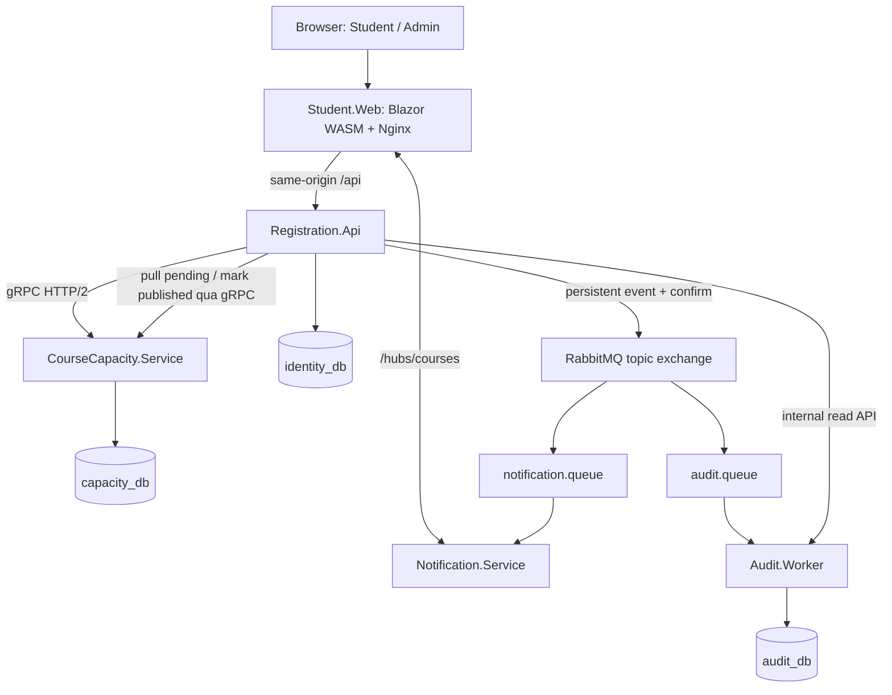

# Kiến trúc

## Sơ đồ tổng thể

Nginx chạy trong container Student.Web, phục vụ static assets và proxy API/SignalR. Không có API Gateway service riêng. PostgreSQL có ba database logic, mỗi service chỉ truy cập database mình sở hữu.

## Quyền sở hữu

| Thành phần | Sở hữu/trách nhiệm | Ranh giới |
|---|---|---|
| Registration.Api | REST, xác thực/phân quyền, identity_db, gRPC client, Outbox publisher, audit proxy | Không ghi đăng ký/sức chứa trực tiếp |
| CourseCapacity.Service | Môn/lớp/lịch/đăng ký, transaction, operation ledger, Outbox | Không public REST cho browser, không publish RabbitMQ trực tiếp |
| Notification.Service | RabbitMQ consumer và SignalR Hub | Không quyết định đăng ký, không ghi DB nghiệp vụ |
| Audit.Worker | RabbitMQ consumer, audit_db và internal read-only API | Không ghi capacity_db, không phục vụ browser trực tiếp |
| Student.Web | Blazor UI, REST/SignalR client, Nginx proxy | Không truy cập gRPC/DB/broker trực tiếp |
| Shared.Contracts | Protobuf, DTO sự kiện, error/outcome constants | Không chứa EF entity, DbContext, business logic hoặc secret |

## Luồng đăng ký

1. Browser gửi POST `/api/registrations` với JWT và `Idempotency-Key`.
2. Registration.Api lấy `student_id` từ token, gọi `ReserveSeat` qua gRPC.
3. CourseCapacity.Service khóa row lớp, kiểm tra trùng/sức chứa, cập nhật enrollment/count/version, ghi operation outcome và Outbox trong cùng transaction.
4. API trả kết quả sau commit, không chờ RabbitMQ.
5. Publisher kéo event từ Capacity, publish persistent message, chờ confirm/routability rồi mới đánh dấu published.
6. Hai queue độc lập chuyển event cho Notification và Audit. Audit commit/dedup trước ACK; SignalR gửi snapshot có version. Client bỏ qua version cũ và resync qua REST khi reconnect.

Delivery là **at-least-once**; không tuyên bố exactly-once. Outbox và subscriber dedup/versioning làm retry an toàn trong phạm vi thiết kế.

## Công nghệ

Các project target `net10.0`. Web UI là Blazor WebAssembly standalone. Phiên bản .NET packages được pin tập trung trong [`Directory.Packages.props`](../Directory.Packages.props); SDK và container images cũng dùng phiên bản cụ thể trong `global.json` và `docker-compose.yml`. Release restore/build đã xác minh package set trong môi trường hiện tại. Compose image build/runtime vẫn cần Docker Engine để kiểm chứng.
